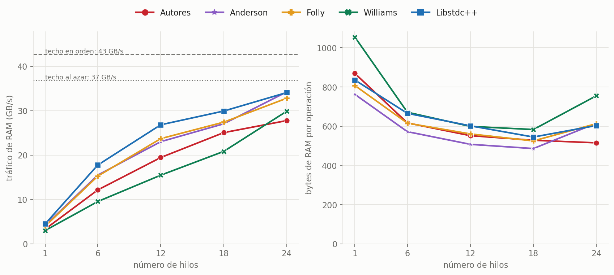
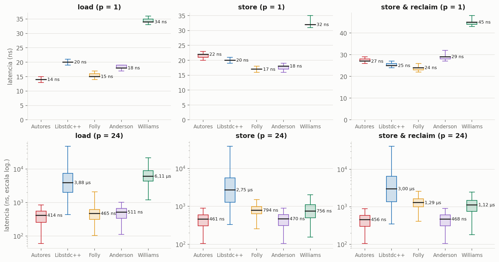
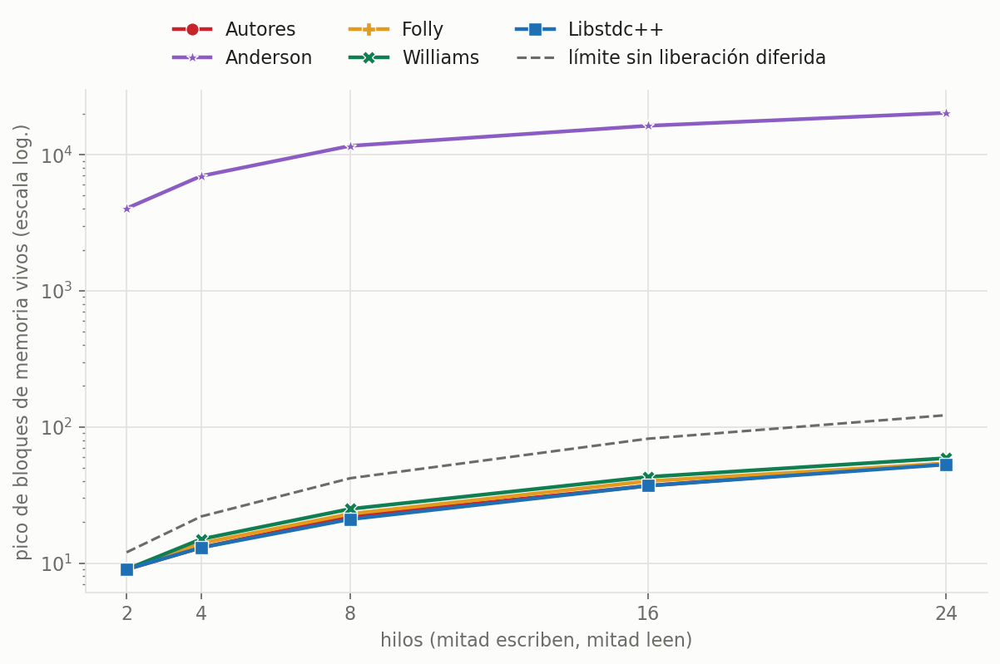
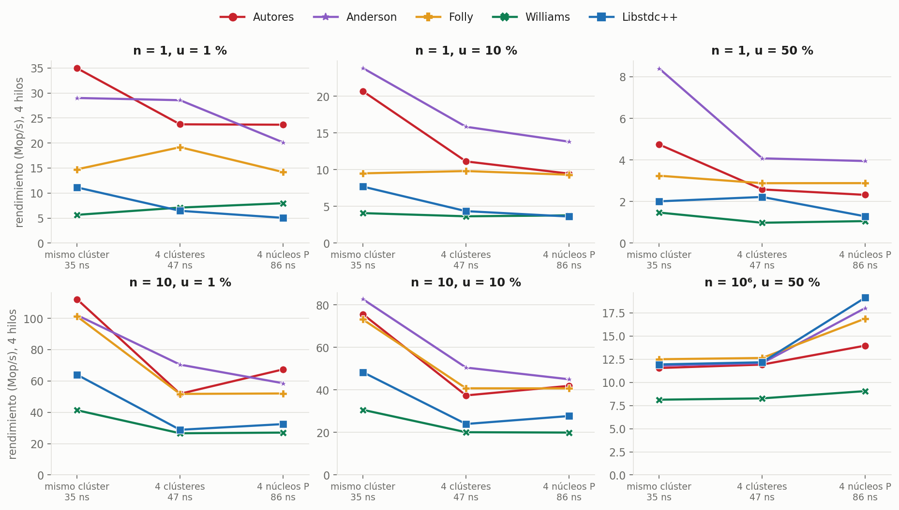
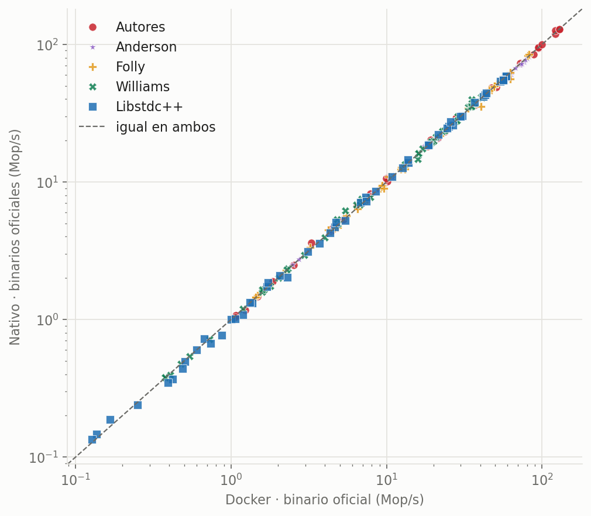
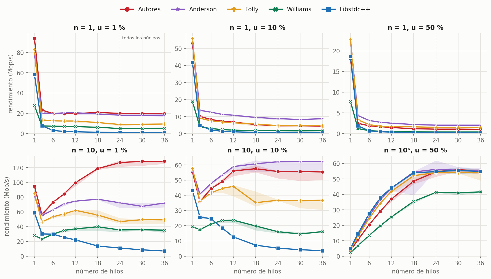
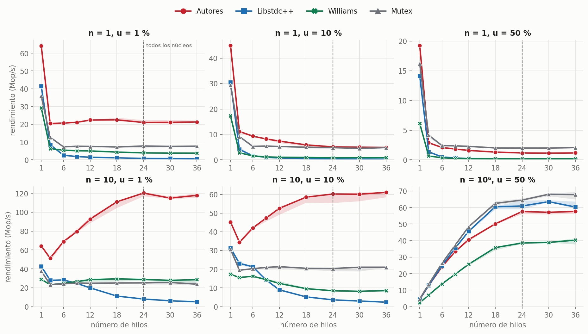

# Réplica completa, explicada desde cero

Este documento explica, paso a paso y sin dar nada por sabido, el paper **«A Fast Wait-Free Solution to Read-Reclaim Races in Reference Counting»** (de Wolff, Anderson, Keller y Seletskiy, Euro-Par 2024), los cinco algoritmos que compara y lo que salió al repetir sus experimentos en un Intel Core Ultra 9 285.

Está escrito para alguien que nunca ha oído hablar de esto. Por eso cada idea importante aparece varias veces y de formas distintas: con una historia, con una tabla paso a paso y con lo que hace el código de verdad. Si una explicación no te convence, la siguiente quizá sí.

**Cómo leerlo**

| Si quieres… | Ve a… |
|---|---|
| Saber qué salió, en dos minutos | [Parte 0](#parte-0-el-resumen-en-dos-minutos) |
| Entender el problema | [Parte 1](#parte-1-el-problema-contado-con-una-biblioteca) |
| Aprender el vocabulario | [Parte 2](#parte-2-las-palabras-que-hacen-falta) |
| Entender cada algoritmo | [Parte 3](#parte-3-los-algoritmos-uno-por-uno) |
| Saber cómo se midió | [Parte 4](#parte-4-cómo-se-hizo-la-réplica) |
| Entender la simulación de los 4 Xeon | [Parte 5](#parte-5-simular-4-xeon-con-una-sola-cpu) |
| Ver y entender los resultados | [Parte 6](#parte-6-los-resultados-explicados) |
| Ver qué afirmaciones del paper se sostienen | [Parte 7](#parte-7-el-veredicto-afirmación-por-afirmación) |
| Saber qué no se pudo hacer | [Parte 8](#parte-8-limitaciones-dicho-sin-rodeos) |
| Repetirlo todo | [Parte 9](#parte-9-cómo-repetirlo-todo) |
| Buscar una palabra | [Parte 10](#parte-10-glosario) |
| Saber de dónde sale cada dato o idea | [Referencias y fuentes](#referencias-y-fuentes) |
| Saber qué hace cada archivo de la carpeta | [README.md](README.md) |

---

## Parte 0. El resumen en dos minutos

**Qué se hizo.** Se repitió el paper en un PC con un Intel Core Ultra 9 285 de 24 núcleos, con sus cinco algoritmos y sus programas oficiales. Este PC no tiene 4 chips, así que esa distancia se simuló colocando los hilos en núcleos concretos. Después se repitió todo sin Docker, con los mismos programas oficiales y con el programa del equipo, y se añadieron controles para entender cada diferencia.

| Tanda | Algoritmos | Mediciones | Fallidas |
|---|---|---|---|
| Con Docker, programas oficiales | Autores, Anderson, Folly, Williams, Libstdc++ | 3 720 | 0 |
| Sin Docker, programas oficiales | Los mismos 5 | 4 660 | 0 |
| Sin Docker, `bench.cpp` del equipo | Autores, Williams, Libstdc++, Mutex | 2 976 | 0 |
| Sin Docker, `bench.cpp` con las pilas alineadas | Los mismos 4 | 2 160 | 0 |
| Controles | Según el caso | 546 | 0 |
| Tráfico real de RAM | Los 5 del paper y el techo de la máquina | 70 | 0 |
| Detectores de errores en los rivales | Los 5 del paper y Mutex | 26 | 0 |

**Las respuestas cortas**

| Pregunta | Respuesta |
|---|---|
| ¿El algoritmo del paper es correcto? | Sí en lo probado: 0 errores con ASan y TSan |
| ¿Cumple su promesa wait-free? | Sí: reintentó como máximo 8 veces, con una cota de 32 |
| ¿Deja memoria sin liberar? | No. Anderson sí retiene algo: 469 KB con 24 hilos |
| ¿Tiene el `load` más rápido? | Sí, aunque con contención por poco |
| ¿Gana a Libstdc++ y a Williams? | Sí, con y sin Docker |
| ¿Gana a Folly? | Aquí no: gana 3 escenarios, empata 2 y pierde 1, con y sin Docker. La causa sigue sin aclarar |
| ¿Gana a Anderson? | Depende. Con pocas escrituras, sí. Con muchas sobre pocas pilas, Anderson llega a 1,99× |
| ¿Importa dónde cae cada hilo? | Con contención, mucho: hasta −55 %. Sin contención, casi nada: ±3 % como mucho |
| ¿Docker cambia los resultados? | No: los programas oficiales rinden lo mismo dentro y fuera (mediana de 0,99× a 1,01× según el algoritmo). La excepción es Williams entre clústeres, y ahí cambian más cosas que Docker |
| ¿Los rivales rompen la memoria? | No en lo probado: 0 avisos en los seis |
| ¿Por qué todos empatan con un millón de pilas? | Muy probablemente por la RAM: Anderson, Libstdc++ y Folly llegan al 89-93 % de lo que da este PC, que tiene un solo módulo de memoria |

**Lo más valioso que salió por el camino**

1. **`bench.cpp` del equipo tiene compartición falsa.** Sus 10 pilas caben en 2 líneas de caché, y eso frena a Autores hasta 3,65 veces. Con una sola palabra añadida, sube de 32 a 119 Mop/s, casi los 122 del programa oficial. La batería completa con esa palabra lo confirma: de 35 a 120 Mop/s. Ver la [Parte 6.6](#66-la-versión-sin-docker).
2. **El binario oficial de latencia se compila sin `-mcx16`.** Con eso, Williams lleva un candado escondido. Lo medimos mal al principio; ya está corregido, y cambia el veredicto: con contención **no** es el peor. Ver la [Parte 6.2](#62-latencia-la-figura-6).
3. **Importa compartir caché, no tanto la distancia.** Dos hilos que comparten L2 rinden casi el doble que cualquier otra pareja, y da igual que el viaje dure 47 o 86 ns. Ver la [Parte 6.4](#64-la-simulación-de-los-4-xeon-importa-la-distancia).
4. **Williams se hunde entre clústeres, pero solo en el programa oficial.** Con Docker cae un 97 % en los 7 pares probados. Sin Docker también se hunde, aunque menos: un 76 %, con rondas que saltan de 0,34 a 1,79 Mop/s. Así que Docker no lo provoca, pero algo de lo que cambia entre las dos tandas cambia cuánto. Se descartaron también `boost::atomic` y un par defectuoso. La causa sigue abierta. Ver la [Parte 6.4](#64-la-simulación-de-los-4-xeon-importa-la-distancia).

5. **Con un millón de pilas, el freno es sobre todo la RAM.** Los contadores de la CPU muestran que este PC mueve unos 37 GB/s en accesos al azar, y Anderson, Libstdc++ y Folly llegan a 33-34. Ver la [Parte 6.1](#61-rendimiento-la-figura-5).

6. **Docker no cambia los programas oficiales.** Se midieron dentro y fuera: de los 270 puntos de la figura 5, 259 cambian menos de un 10 %. Antes era una deducción; ahora está medido. Ver la [Parte 6.6](#66-la-versión-sin-docker).

**Lo que falta.** Ya no queda nada por medir de lo planeado: la tanda sin Docker con los programas oficiales terminó el 7 de noviembre de 2026, sin un solo fallo. Lo que queda son preguntas: por qué Folly rinde aquí mucho más que en el paper, por qué Williams se hunde entre clústeres, por qué Autores va por detrás con n = 10⁶ y pocos hilos, y si la RAM es de verdad el techo. Además, la latencia con contención sigue cambiando mucho de una ronda a otra, incluso con 15 rondas, así que sus diferencias pequeñas no valen como victoria. La [Parte 8](#parte-8-limitaciones-dicho-sin-rodeos) lo cuenta y la [Parte 9](#parte-9-cómo-repetirlo-todo) explica cómo repetirlo.

---

## Parte 1. El problema, contado con una biblioteca

### 1.1 Lo que hay que saber antes

Un programa guarda sus datos en la **memoria**. Cada dato vive en una dirección, igual que cada libro vive en un estante numerado. Un **puntero** es un número que dice en qué dirección está algo: es una ficha que pone «estante 42».

Un **hilo** es una tarea que corre en un núcleo del procesador. Tener varios hilos es como tener varias personas trabajando a la vez en el mismo edificio. Pueden ir a la vez y ninguna ve lo que hace la otra hasta que mira.

Cuando un dato ya no hace falta hay que **liberarlo**, es decir, devolver su sitio para que se reutilice. Si no se libera, la memoria se va llenando. Si se libera demasiado pronto, alguien puede ir a buscarlo y encontrarse otra cosa o nada. Eso es el error más temido de esta historia: el **use-after-free**, «usar después de liberar». Según el paper, es una causa habitual de agujeros de seguridad.

### 1.2 El conteo de referencias

La forma más sencilla de saber cuándo liberar algo es llevar la cuenta de cuánta gente lo está usando.

> Cada libro lleva pegada una libreta con un número: cuántas personas lo usan.
> Quien empieza a usarlo suma 1. Quien termina resta 1.
> Quien deja la libreta en 0 sabe que era el último y tira el libro a la trituradora.

Eso es el **conteo de referencias**. En C++ se llama `shared_ptr`, en Rust `Arc`. Con un solo hilo funciona perfecto.

### 1.3 El tablón: la variable que cambia

Ahora añadimos una pieza clave. En el vestíbulo hay un **tablón** que dice cuál es «el libro del día»: «estante 42». Cualquiera puede leerlo y un bibliotecario puede cambiarlo.

En el paper, ese tablón es un **atomic shared pointer**: una variable compartida, que varios hilos leen y escriben a la vez, y que apunta a un objeto con contador de referencias. Tiene dos operaciones:

- **`load`** (cargar): leer el tablón y quedarte con una referencia al libro.
- **`store`** (guardar): cambiar el tablón para que señale otro libro.

### 1.4 La carrera, en forma de historia

Marta (un hilo lector) y Beto (un hilo escritor) trabajan a la vez. El libro del estante 42 solo lo «usa» el tablón, así que su libreta marca 1.

1. Marta mira el tablón y lee «estante 42». Se dirige hacia allí.
2. Antes de que llegue, Beto cambia el tablón a «estante 77».
3. Beto va a la libreta del libro 42 y resta 1. Queda en 0. ¡Era el último!
4. Beto tira el libro 42 a la trituradora.
5. Marta llega y quiere sumar 1 en la libreta… de un libro que ya no existe.

Marta está escribiendo sobre una libreta destruida. En el ordenador, ese trozo de memoria puede pertenecer ya a otra cosa. Eso es una **carrera read-reclaim**: una lectura compite con una liberación.

### 1.5 La misma carrera, en forma de tabla

| Momento | Marta (lee) | Beto (escribe) | Tablón | Libreta del libro 42 |
|---|---|---|---|---|
| 0 | | | 42 | 1 |
| 1 | lee «42» | | 42 | 1 |
| 2 | | pone «77» | 77 | 1 |
| 3 | | resta 1 | 77 | **0** |
| 4 | | **tritura el libro** | 77 | destruida |
| 5 | **suma 1: ¡use-after-free!** | | 77 | destruida |

### 1.6 La misma carrera, en forma de código

```text
load:                        store(nuevo):
  p = tablon                   viejo = intercambiar(tablon, nuevo)
  // ← AQUÍ puede pasar        viejo.contador -= 1
  //   todo lo de la derecha   si viejo.contador == 0: liberar(viejo)
  p.contador += 1
  devolver p
```

El agujero está entre las dos líneas de `load`. Son dos pasos separados y en medio puede ocurrir cualquier cosa.

### 1.7 Por qué no se arregla fácil

La idea obvia es hacer los dos pasos «a la vez». El problema es físico: el tablón y la libreta están **en dos sitios distintos de la memoria**, y los procesadores actuales solo pueden hacer una operación indivisible sobre **un sitio**. Es como si solo pudieras tocar una cosa con la mano en cada instante.

Hay tres grandes familias de solución, y todo el paper gira en torno a ellas:

1. **Poner un candado**: mientras alguien lee, nadie cambia nada. Simple, pero se forman colas. *(Mutex y Libstdc++)*
2. **Retrasar la trituradora**: no se destruye nada hasta estar seguros de que nadie va de camino. Rápido, pero la basura se acumula un rato. *(Anderson)*
3. **Pagar por adelantado en el propio tablón**: juntar el puntero y una cuenta en un solo sitio, para que leer y reservar sean el mismo gesto. *(Williams, Folly y los Autores)*

La aportación del paper es una versión de la tercera familia que, además, garantiza que nadie se queda atascado.

---

## Parte 2. Las palabras que hacen falta

### 2.1 Operaciones atómicas

Una operación es **atómica** si ocurre entera o no ocurre, sin que nadie pueda ver un estado a medias. Las que aparecen aquí son:

| Operación | Qué hace | Analogía |
|---|---|---|
| `fetch_add` / `fetch_sub` | suma o resta y te dice el valor anterior | arrancar el papelito de un taco de turnos: te llevas tu número y el taco queda actualizado |
| `exchange` | pone un valor nuevo y te devuelve el viejo | cambiar el cartel y quedarte con el antiguo en la mano |
| `CAS` (compare-and-swap) | «si vale X, ponlo a Y; si no, no hagas nada y dime cuánto vale» | «solo cambio el cartel si sigue poniendo lo que yo leí» |
| `DWCAS` | un CAS sobre 16 bytes en vez de 8 | lo mismo sobre un cartel doble; existe, pero es más lento |

La diferencia entre `fetch_add` y `CAS` es la clave de todo el paper:

- **`fetch_add` nunca falla.** Pides tu turno y lo tienes, aunque haya mil personas.
- **`CAS` puede fallar.** Si alguien cambió el valor justo antes, no pasa nada y tienes que reintentar. Con mucha gente, puedes perder una y otra vez.

### 2.2 Garantías de progreso: la parte «wait-free» del título

Imagina una puerta por la que tiene que pasar todo el mundo.

| Garantía | Qué promete | Analogía | Peligro |
|---|---|---|---|
| **Bloqueante** | nada, si alguien se detiene | hay una sola llave; quien la tiene se duerme y **todos** esperan | un hilo parado detiene a los demás |
| **Lock-free** | alguien siempre avanza | puerta giratoria a empujones: siempre pasa alguien, pero **tú** podrías perder eternamente | un hilo concreto puede quedarse atrás |
| **Wait-free** | **todos** acaban en un número máximo de pasos | cada persona tiene su torniquete: pase lo que pase, terminas en N pasos | es lo más difícil de conseguir |

Otra forma de verlo: bloqueante es «depende de los demás», lock-free es «depende de la suerte», wait-free es «no depende de nadie».

Wait-free **no significa más rápido**. Significa más predecible. Se puede ser wait-free y lento, igual que se puede ser muy rápido de media y tener a un hilo sufriendo. Esto importará al leer los resultados.

### 2.3 Caché, líneas y por qué compartir es caro

Este es el concepto que explica casi todas las gráficas.

Cada núcleo tiene una memoria pequeña y rapidísima pegada a él: la **caché**. Los datos se mueven en bloques de 64 bytes llamados **líneas de caché**. Para escribir en una línea, un núcleo debe tenerla **en exclusiva**: hay que quitársela al que la tenía.

> Imagina que todos deben escribir en **un único cuaderno**. No se puede fotocopiar: para escribir hay que tenerlo en la mano. Si 20 personas quieren escribir, el cuaderno viaja de mano en mano. El trabajo real dura un instante; lo que consume tiempo es **pasarse el cuaderno**.

Por eso, cuando todos los hilos escriben en la misma variable, añadir hilos **no acelera nada**: el cuaderno sigue siendo uno. Eso se llama **contención**.

Y aquí entra la distancia. Pasar el cuaderno a tu compañero de mesa es rápido. Enviarlo a otro edificio es lento. En un ordenador con varios **sockets** (varios chips en la misma placa), mandar una línea a otro socket es varias veces más lento que dentro del mismo chip. Por eso, en la máquina del paper, con 4 chips, importa dónde cae cada hilo.

### 2.4 Cómo leer los números

- **Mop/s**: millones de operaciones por segundo. Más es mejor. Mide **rendimiento**, cuánto trabajo total sale.
- **ns y µs**: nanosegundos y microsegundos (1 µs = 1 000 ns). Menos es mejor. Miden **latencia**, cuánto tarda una operación.
- **Mediana (p50)**: la mitad de las medidas fue más rápida y la otra mitad más lenta. Es la operación típica.
- **p99**: el 99 % fue más rápido que esto. Es «lo malo que puede ponerse». Si la mediana es buena y el p99 horrible, la experiencia es a tirones.

Rendimiento y latencia no son lo mismo. Una autopista puede mover muchos coches por hora aunque cada uno tarde bastante. Por eso el paper mide las dos cosas.

Hay una trampa más. Como lo que viaja es la línea entera, dos datos **distintos** que caen en la misma línea se estorban, aunque nadie los comparta. Se llama **compartición falsa** (*false sharing*), y en esta réplica costó hasta 3,65 veces de rendimiento: ver la [Parte 6.6](#66-la-versión-sin-docker).

---

## Parte 3. Los algoritmos, uno por uno

Vamos de lo más simple a lo más sofisticado. Todos resuelven el mismo problema de la Parte 1, y para cada uno verás: la idea en una frase, la analogía, el paso a paso, y qué lo hace bueno o malo.

### 3.0 La versión ingenua (la que está rota)

**Idea:** leer el puntero y luego sumar 1 al contador.

Es exactamente lo de la Parte 1. Está en `codigo/estres_asan.cpp` solo para demostrar el fallo: AddressSanitizer, un detector de errores de memoria, lo atrapa en cuanto se ejecuta (ver [Parte 6.5](#65-corrección-funciona-sin-romperse)). No aparece en el paper como rival porque no es una solución, es el problema.

### 3.1 Mutex (referencia del equipo, no está en el paper)

**Idea en una frase:** una sala con una sola llave: solo entra uno.

**Analogía:** el tablón está en una sala cerrada. Para mirarlo o cambiarlo pides la llave. Si está ocupada, **te sientas a dormir** y te despiertan cuando quede libre.

**`load`, paso a paso:**

1. Pedir la llave. Si no está libre, el sistema operativo te duerme.
2. Leer el puntero.
3. Sumar 1 al contador. Nadie puede cambiar nada: estás solo.
4. Devolver la llave.

**`store`, paso a paso:**

1. Pedir la llave.
2. Cambiar el puntero.
3. Devolver la llave.
4. Soltar el objeto viejo, ya fuera de la sala, para no retener a nadie.

| | |
|---|---|
| **Garantía** | Bloqueante |
| **Memoria extra** | Ninguna; libera al instante |
| **A favor** | Muy simple y correcta. Dormir evita gastar CPU |
| **En contra** | Se forman colas; si quien tiene la llave se para, todos esperan. Dormir y despertar es lento, por eso su p99 es malísimo |

### 3.2 Libstdc++ (`std::atomic<std::shared_ptr>` de GCC)

**Idea en una frase:** un pestillo diminuto dentro del propio puntero, y quien no entra se queda dando vueltas a la puerta.

**Analogía:** es como el Mutex, pero el «cerrado» es un puntito en la esquina del propio tablón. No hay sala de espera: quien quiere entrar **se queda de pie mirando** el puntito hasta que se apaga.

**El truco técnico.** Los objetos están alineados en memoria, así que el último bit de un puntero siempre vale 0. GCC aprovecha ese bit como pestillo: `0` libre, `1` ocupado.

**`load`, paso a paso** (`bits/shared_ptr_atomic.h`):

1. Mirar el bit. Si está a 1, esperar dando vueltas.
2. Con un `CAS`, ponerlo a 1. Si otro se adelantó, volver al paso 1.
3. Leer el puntero y sumar 1 al contador.
4. Restar 1 a la palabra para apagar el bit.

**`store`, paso a paso:**

1. Encender el bit igual que antes.
2. Con un `exchange`, poner el puntero nuevo; eso además apaga el bit.
3. Soltar el objeto viejo.

| | |
|---|---|
| **Garantía** | Bloqueante |
| **Memoria extra** | Ninguna; libera al instante |
| **A favor** | Viene con el compilador, y sin contención es muy ágil |
| **En contra** | Cada lectura escribe dos veces en la línea más disputada. Si quien tiene el bit pierde su turno de CPU, todos dan vueltas en vano |

Con un solo hilo es rápido, porque nadie compite. En cuanto hay contención se hunde, y por eso en el paper pasa de 7 Mop/s con un hilo a 0,1 con 144.

### 3.3 Williams (split reference count con 16 bytes)

**Idea en una frase:** apuntarse en el tablón *antes* de ir a la libreta, para que nadie tire el libro mientras vas de camino.

**Analogía:** el tablón tiene dos columnas: la ficha del libro y una rayita por cada persona que **va de camino**. Antes de ir, haces una rayita. Cuando ya sumaste 1 en la libreta, borras tu rayita. Si Beto cambia el tablón, ve las rayitas y sabe cuánta gente viene en camino, y las pasa a la libreta para que el libro no se destruya.

A esto se le llama **contador partido** (*split reference count*): una parte de la cuenta vive junto al puntero (la **local**) y otra en la libreta (la **global**).

**Lo que hay físicamente:** puntero de 8 bytes más 8 bytes de contadores, en total **16 bytes**, que se manejan con `DWCAS`, la instrucción `cmpxchg16b`.

**`load`, paso a paso** (`local_access` en `codigo/williams/atomic_shared_ptr`):

1. Leer los 16 bytes.
2. Bucle `DWCAS`: sumar 1 a `access_count`. Si alguien tocó el tablón, repetir.
3. Sumar 1 en la libreta (ya no hay peligro: mi rayita protege el objeto).
4. Bucle `DWCAS`: restar 1 a `access_count`.
5. Si el puntero cambió mientras tanto, avisar en la libreta con `remove_external_counter`.

**`store`, paso a paso:**

1. Intercambiar los 16 bytes por los nuevos.
2. Pasar las rayitas que quedaban a la libreta del objeto viejo.
3. Restar la referencia que tenía el tablón.

| | |
|---|---|
| **Garantía** | Lock-free |
| **Memoria extra** | Ninguna; libera al instante |
| **A favor** | Sin candados: nadie bloquea a nadie |
| **En contra** | Dos bucles de `DWCAS` por lectura, además de la libreta. Mucho trabajo por operación |

Fíjate en lo importante: **cada lectura toca el tablón dos veces**. Los Autores lo tocan una sola.

**Una nota práctica.** Esos 16 bytes solo se pueden cambiar de golpe con la instrucción `cmpxchg16b`, y el compilador solo la usa si se le pide con `-mcx16`. Sin esa bandera, `boost::atomic` mete un candado por dentro, sin avisar, y Williams deja de ser lock-free. Nos pasó: ver la [Parte 6.2](#62-latencia-la-figura-6).

### 3.4 Folly (Facebook/Meta)

**Idea en una frase:** Williams, pero metiéndolo todo en 8 bytes y repartiendo las rayitas en lote.

**Analogía:** en lugar de un tablón doble, Folly aprovecha que los punteros reales solo usan 48 de sus 64 bits. En los 16 bits libres cabe el contador local. Además, el libro ya tiene anotada de antemano una **provisión de 8 192 usuarios** en su libreta, así que las lecturas casi nunca necesitan ir a ella.

**`load`, paso a paso** (`takeOwnedBase` en `AtomicSharedPtr.h`):

1. Leer los 8 bytes.
2. Bucle `CAS` para sumar 1 al contador local. Si otro se adelantó, repetir.
3. Si el contador local pasa de 4 096, trasladar un lote de 4 096 a la libreta y restarlo del contador local.
4. Si llegara a 8 192 (más lectores simultáneos que provisión), **esperar** cediendo el turno.

**`store`, paso a paso:**

1. Dar al objeto nuevo su provisión de 8 192 en la libreta.
2. Con un `exchange`, poner el nuevo y quedarse con el viejo.
3. Ajustar la libreta del viejo según cuántas lecturas se consumieron.

| | |
|---|---|
| **Garantía** | Lock-free; bloqueante en el caso extremo de más de 8 192 hilos |
| **Memoria extra** | Ninguna; libera al instante |
| **A favor** | Una sola operación de 8 bytes por lectura, y la libreta casi no se toca |
| **En contra** | Usa `CAS` en bucle: **puede perder y reintentar**. Con mucha contención, ese bucle domina |

Es casi la misma idea que los Autores. La gran diferencia es una sola instrucción: Folly usa `CAS` (puede fallar), los Autores usan `fetch_add` (no falla). Folly hace esto porque necesita comprobar que no se desborda su contador de 16 bits.

**Un aviso antes de ver los resultados.** En el paper, Folly sale muy mal parado: con contención rinde entre 0,05× y 0,07× de lo que rinden los Autores. En esta réplica eso no pasa. No pasa con Docker, no pasa sin Docker y no pasa con la receta exacta del paper. La [Parte 6.1](#61-rendimiento-la-figura-5) lo cuenta, y explica por qué la causa sigue abierta.

### 3.5 Anderson (hazard pointers)

**Idea en una frase:** antes de ir al libro, pon un cartel en tu mesa diciendo cuál usas; y quien quiera destruir algo, antes revisa todas las mesas.

**Analogía:** cada persona tiene una mesa con un cartelito. Quien va a usar el libro 42 escribe «42» en su cartelito. Cuando un bibliotecario va a tirar algo, no lo tira: lo mete en una **caja de pendientes**. Cada 2 000 cosas en la caja, recorre todas las mesas, y solo destruye lo que no aparezca en ningún cartelito.

Un **hazard pointer** es ese cartelito: un puntero que declara «ojo, estoy usando esto».

**Un detalle muy fino, que comprobamos en el código y en la prueba.** El **objeto** se destruye al instante; lo que espera en la caja es solo el **bloque de control** (la libreta). La libreta debe sobrevivir porque un lector despistado podría aún intentar sumarle 1, y necesita una respuesta segura: «este libro ya no existe». Por eso esa suma usa un contador especial que, una vez en 0, ya no sube (`increment_strong_count_if_nonzero`).

**`load`, paso a paso** (`atomic_shared_ptr.hpp`):

1. Leer el puntero del tablón.
2. Escribirlo en mi cartelito (mi hazard pointer).
3. Volver a leer el tablón. Si cambió, volver al paso 2 con el valor nuevo.
4. Intentar sumar 1 al contador. Si estaba en 0, el objeto ya murió: repetir desde el paso 1.
5. Borrar mi cartelito.

**`store`, paso a paso:**

1. Con un `exchange`, poner el puntero nuevo.
2. Restar 1 al contador del viejo.
3. Si llega a 0: destruir el objeto y meter su bloque de control en mi caja.
4. Cada 2 000 retiradas, revisar los cartelitos de todos y liberar lo que nadie protege.

| | |
|---|---|
| **Garantía** | Lock-free |
| **Memoria extra** | **Sí**: bloques de control pendientes, hasta unos 2 000 por hilo escritor o más |
| **A favor** | **Leer no escribe en el tablón**: varios lectores no se estorban ahí, y un `CAS` no falla porque otro haya leído |
| **En contra** | Memoria retenida. Cada `cleanup` recorre todos los hilos, y causa picos de latencia (medidos en la [Parte 6.2](#62-latencia-la-figura-6)) |

Este punto explica mucho: en Autores, Folly y Williams **leer modifica el tablón**. En Anderson no. Por eso, cuando hay muchas actualizaciones sobre una sola pila, Anderson sale ganando: su `CAS` no falla por culpa de los lectores.

### 3.6 Autores (el algoritmo del paper)

**Idea en una frase:** el tablón guarda un taco de vales prepagados, y arrancar un vale te da la dirección del libro en un solo gesto indivisible.

Esta es la parte central, así que va con calma y de varias formas.

#### La historia de los vales

El bibliotecario pone el libro 42 en el tablón, y **antes** anota en la libreta del libro: «hay 100 usuarios». Esos 100 son imaginarios: son 100 vales que deja en un taco pegado al tablón.

Cuando Marta quiere el libro, **arranca un vale**. El vale lleva impreso «estante 42». En un único gesto ha hecho dos cosas: ha leído dónde está el libro y se ha llevado una reserva pagada. Ya no hay momento peligroso, porque no hay dos pasos.

Fíjate en lo bonito: Marta **ni ha tocado la libreta**. El libro ya contaba con ella.

Cuando Beto cambia el tablón, se lleva el taco con los vales que queden, digamos 97. Va a la libreta y resta esos 97, porque nadie los usará. Quedan 3: justo los 3 vales que hay en manos de la gente. El libro sigue vivo. Cada vez que alguien termina, resta 1. El último deja la libreta en 0 y lo tira **en ese mismo instante**. Sin retrasos, sin caja de pendientes.

#### La regla de oro

> **Libreta = vales en el taco + vales en manos de la gente.**

Mientras esa igualdad se cumpla, nunca puede llegar a 0 algo que alguien pueda usar. En el paper, a cada vale se le llama **peso** (*weight*), y al sistema, **conteo de referencias ponderado**.

#### Cómo cabe todo en una palabra

Para que arrancar el vale y leer la dirección sean un solo gesto, la dirección y la cantidad de vales deben estar en la **misma palabra de 64 bits**:

```text
 63                    45 44                                        0
┌────────────────────────┬──────────────────────────────────────────┐
│   peso: 19 bits        │   puntero: 45 bits                       │
└────────────────────────┴──────────────────────────────────────────┘
```

Los punteros reales usan 48 bits, y los 3 últimos siempre son 0 por alineación. Eso deja 19 bits libres para el peso: hasta **C = 2¹⁹ − 1 = 524 287** vales.

#### Ejemplo completo con números pequeños

Tomamos C = 10 vales como máximo y P = 3 hilos como máximo (cumple la regla C ≥ 2P, que luego explicamos).

| Paso | Quién | Acción | Tablón | Libreta de A | Libreta de B |
|---|---|---|---|---|---|
| 0 | | situación inicial | (A, 10) | 10 | |
| 1 | Marta | `load`: `fetch_sub` del peso | (A, 9) | 10 | |
| 2 | Luis | `load`: `fetch_sub` del peso | (A, 8) | 10 | |
| 3 | Beto | prepara B: suma C a su libreta | (A, 8) | 10 | 10 |
| 4 | Beto | `exchange`: pone B y se lleva (A, 8) | (B, 10) | 10 | 10 |
| 5 | Beto | resta los 8 vales sobrantes a A | (B, 10) | **2** | 10 |
| 6 | Marta | termina: resta 1 | (B, 10) | 1 | 10 |
| 7 | Luis | termina: resta 1 | (B, 10) | **0 → destruido** | 10 |

Comprueba la regla de oro en el paso 2: 8 en el taco + 2 en mano = 10. ✔️ Y en el paso 5: 0 en el taco + 2 en mano = 2. ✔️

**Compáralo con la carrera de la Parte 1.** Ahí Marta leía y luego sumaba, y en medio Beto destruía. Aquí Marta no tiene un «luego»: su reserva ya está hecha.

#### `load` y `store`, paso a paso

**`load`:**

1. `fetch_sub`: quitar 1 al peso. Devuelve puntero y peso anterior. Nunca falla.
2. Si el peso sigue siendo suficiente (≥ P), **fin**. Es casi siempre: un único paso atómico.
3. Si bajó de P, recargar llamando a `increase_weight` (ver abajo).

**`store`:**

1. Sumar C − 1 a la libreta del objeto nuevo.
2. `exchange`: poner (nuevo, C) y quedarse con (viejo, peso).
3. Restar `peso` a la libreta del viejo. Si llega a 0, se destruye ya.

Tres pasos, sin bucles. Por eso es **wait-free** y de tiempo constante.

#### La recarga, y por qué es la verdadera aportación

El taco se agota. Antes de eso hay que recargar. Si la recarga pudiera reintentarse para siempre, el algoritmo no sería wait-free. Aquí está la novedad del paper.

Cuando el peso cae por debajo de P, el hilo llama a `increase_weight`:

1. Suma a la libreta los vales que va a añadir: C − peso.
2. Intenta con un `CAS` cambiar (A, peso) por (A, peso + C − peso_inicial).
3. Si funciona, listo.
4. Si falla, mira **por qué** falló:

| Lo que ve al fallar | Qué significa | Qué hace |
|---|---|---|
| El puntero ya es otro | Beto cambió el tablón: recargar ya no sirve | Deshace la suma y sale |
| El peso **subió** | Otro hilo ya recargó | Deshace la suma y sale |
| El peso **bajó** | Otro hilo arrancó un vale | Reintenta con el peso nuevo |

La pregunta es: ¿cuántas veces se puede repetir? Solo reintenta si el peso bajó. Y el peso empezó por debajo de P y nunca baja de 0. Por tanto, reintenta **como mucho P veces**. Ahí está la cota, sin depender de la suerte.

Algoritmos anteriores salían solo si el `CAS` funcionaba o si el peso era suficiente. El truco nuevo es salir **también en cuanto se detecta que otro ya recargó**, aunque el peso vuelva a estar bajo en ese momento.

#### Por qué nunca se acaban los vales (las dos reglas)

- **R-1: C ≥ 2P.** El taco completo tiene al menos el doble de vales que hilos.
- **R-2: el peso solo cambia de dos formas:** bajando de 1 en 1 o saltando a un valor mayor que P.

Dicho con personas: cada hilo solo puede arrancar **un vale de más** antes de ponerse a recargar, porque no puede hacer otro `load` hasta que termine. Con P hilos como máximo, el peso baja como mucho P por debajo del umbral P. Y P − P = 0. Nunca es negativo. Por eso el umbral es precisamente P: deja sitio para que todos los hilos a la vez se pasen una vez.

| | |
|---|---|
| **Garantía** | **Wait-free** en `load` y `store`; lock-free en `CAS` |
| **Memoria extra** | **Ninguna**; libera al instante |
| **A favor** | Una sola operación por lectura, que nunca falla. Y `store` en tiempo constante |
| **En contra** | Leer **modifica** el tablón, así que un `CAS` puede fallar por culpa de un simple lector. Por eso sufre con muchas actualizaciones sobre pocas pilas |

**Una nota sobre versiones.** El binario oficial no usa exactamente el código que se ha explicado aquí. El artefacto trae una versión anterior en la que la cuenta **sube** (`tag`, `fetch_add`) en vez de bajar. La del repositorio del equipo es la que **baja** (`weight`, `fetch_sub`). Son el mismo algoritmo en espejo, como contar los vales usados en vez de los que quedan. En las dos, el camino rápido es una sola instrucción atómica.

### 3.7 Los seis, de un vistazo

| | Atómicas por lectura en la zona disputada | ¿Puede reintentar leyendo? | Garantía del `load` | Liberación | ¿Leer escribe en el tablón? |
|---|---|---|---|---|---|
| Mutex | candado + desbloqueo | espera dormido | Bloqueante | Inmediata | Sí (el candado) |
| Libstdc++ | `CAS` + `fetch_sub` | sí, dando vueltas | Bloqueante | Inmediata | Sí |
| Williams | 2 bucles de `DWCAS` | sí | Lock-free | Inmediata | Sí |
| Folly | 1 bucle de `CAS` | sí | Lock-free | Inmediata | Sí |
| Anderson | ninguna en el tablón (solo lee) | sí, pocas veces | Lock-free | **Diferida** (bloque de control) | **No** |
| **Autores** | **1 `fetch_sub`** | **no** (salvo recarga, ≤ P) | **Wait-free** | **Inmediata** | Sí |

Todos, además, deben sumar y restar en la libreta del objeto cuando hace falta. Y aquí viene una diferencia importante en Autores: al **terminar** de usar el objeto se resta 1 en la libreta. Así que, con una única pila y muchos lectores, hay **dos** líneas calientes: el tablón y la libreta. En Anderson solo hay una, la libreta. Es una explicación razonable de por qué Anderson acaba ganando sobre una sola pila, aunque ojo: con u = 1 %, en el paper eso solo ocurre a partir de unos 54 hilos, y en esta máquina no llega a pasar (ver [Parte 6.1](#61-rendimiento-la-figura-5)).

---

## Parte 4. Cómo se hizo la réplica

### 4.1 Qué hicieron los autores

El paper mide dos cosas:

- **Rendimiento (figura 5)** en una máquina de **4 Intel Xeon E7-8867: 72 núcleos, 144 hilos** de hardware. Se crean *n* pilas concurrentes. Cada operación elige una pila al azar: con probabilidad *u* % saca un elemento y lo mete en otra pila, y si no, lee la cima. Se varía el número de hilos, en 6 combinaciones de (n, u).
- **Latencia (figura 6)** en un **Xeon w7-3465X: 28 núcleos, 56 hilos**. *p* hilos a la vez: el primero se mide y los demás hacen `store` sin parar. Se miden `load`, `store` sin liberar y `store` que libera.

Interpretar n y u es fácil: **n pequeño significa mucha gente en poco sitio**, y **u grande significa mucha escritura**. Con n = 1 todos se pelean por el mismo tablón; con n = 10⁶ casi nunca coinciden.

### 4.2 Qué se usó aquí

Para que la comparación sea justa se usaron **los binarios oficiales**, compilados desde el artefacto publicado en Zenodo (`10.5281/zenodo.11775182`, MD5 comprobado), en la misma imagen base: Ubuntu 22.04 con g++-12. Es decir: el mismo código de los autores, el de Folly y el de Anderson, y el mismo programa de pruebas. No es una reimplementación.

También se corrió `codigo/bench.cpp` del equipo, como comprobación independiente. Son dos programas distintos que deberían contar la misma historia. La [Parte 6.6](#66-la-versión-sin-docker) compara lo que dicen.

Del artefacto se extrajo la receta exacta, que no aparece en el paper:

| Detalle | Valor |
|---|---|
| Orden | `bench_stack -r 10 -s n -u u -i 7 --peek=true --threads=T --alg=A` |
| Algoritmos | `ivo` (Autores), `gnu` (Libstdc++), `jss-free` (Williams), `folly`, `mine` (Anderson) |
| Asignador | `jemalloc` con `LD_PRELOAD` |
| Memoria | `numactl -i all` |
| Hilos | 1, 18, 36, 54, 72, 108, 144, 180, 216 |
| Tamaño de pila | 20 elementos + T/n |
| Resultado | Mediana de 7 ejecuciones de 10 s |

### 4.3 Adaptaciones, y por qué

| Paper | Aquí | Por qué |
|---|---|---|
| Hilos 1 a 216 | **1, 3, 6, 9, 12, 18, 24, 30, 36** | Es la lista del paper dividida entre 6. La proporción se conserva: 24 = «toda la máquina», como 144; 36 = 1,5 veces, como 216 |
| 7 × 10 s, en un mismo proceso | 5 rondas de 2 s, cada punto en un proceso nuevo y en **orden aleatorio** | Reduce el tiempo de la figura 5 de unas 5 h a poco más de 1 h. Además, si la CPU se calienta o algo interrumpe, afecta a todos por igual |
| p = 56 | p = 1, **24** y 56 | 24 son todos los núcleos reales. Con 56 habría más hilos que núcleos; se mide también, pero no es comparable |
| Williams no aparece en la figura 6 | **Sí se midió** | El paper lo omite «porque su latencia casi siempre era mayor», y el artefacto trae esa línea comentada. Se activó esa línea para comprobar la frase, en vez de creerla, y se compiló con `-mcx16` en un binario aparte, porque sin esa bandera lleva un candado escondido (ver la [Parte 6.2](#62-latencia-la-figura-6)). Son los únicos cambios en las pruebas oficiales, además de la lista de valores de p |

Y como recortar puede sesgar, se verificó: varios puntos se repitieron con la receta **exacta** de 10 s × 7 y se comparó (ver [Parte 6.7](#67-validación-de-los-recortes)).

### 4.4 De dónde salen los números del paper

Las figuras del PDF son vectoriales. No hay que leerlas a ojo: `herramientas/extraer_fig5.py` saca la posición exacta de cada marcador y la convierte a Mop/s usando la cuadrícula. El resultado está en `paper_fig5.csv`. Así se compara número contra número.

---

## Parte 5. Simular 4 Xeon con una sola CPU

### 5.1 Qué significa de verdad «simular 4 sockets»

Una máquina de 4 sockets es distinta por dos motivos:

1. **Distancia entre núcleos:** pasar una línea de caché a otro chip es varias veces más lento.
2. **Distancia a la memoria (NUMA):** cada chip tiene su RAM; la del vecino está más lejos.

Una máquina virtual con 4 nodos NUMA engaña al sistema operativo: dice que hay 4 nodos, pero **ningún viaje tarda más**. Sería un decorado. Por eso se descartó.

Lo que importa aquí es lo primero: la línea caliente que viaja. Y eso sí se puede imitar con hardware real, si esta CPU tiene **distancias reales** que aprovechar.

### 5.2 Medir antes de suponer

El Core Ultra 9 285 tiene 8 núcleos rápidos (**P**) y 16 eficientes (**E**). Los E están en **4 clústeres de 4 núcleos**, y cada clúster comparte una caché L2. Exactamente 4 grupos: suena a 4 sockets en miniatura. Pero hay que comprobarlo.

`herramientas/latencia_nucleos.cpp` lanza una «pelota» entre cada par de núcleos y mide cuánto tarda:


Cómo leerla: cada cuadrito es un par de núcleos; **más oscuro es más lento**. Los cuatro bloques claros de la diagonal son los clústeres: dentro de cada uno, los viajes son muy rápidos.

| Viaje entre… | Mediana | Respecto a «mismo clúster» |
|---|---|---|
| Núcleos E del mismo clúster | **35 ns** | 1× |
| Núcleos E de clústeres distintos | **47 ns** | 1,35× |
| Núcleo P y núcleo E | 67 ns | 1,9× |
| Dos núcleos P | **86 ns** | 2,5× |

Dos cosas importantes:

- **Los clústeres sí se comportan como sockets:** cerca dentro, más lejos fuera. La hipótesis se confirma.
- **Sorpresa:** los núcleos P son los **más lejanos entre sí**. Son los más rápidos calculando y los más lentos pasándose datos. No lo habríamos adivinado.

### 5.3 ¿Cuánto se parece a los Xeon reales?

En procesadores de esa generación, una transferencia dentro del socket ronda los [40-45 ns](https://community.intel.com/t5/Intel-Moderncode-for-Parallel/Core-to-Core-Communication-Latency-in-Skylake-Kaby-Lake/m-p/1061670), y entre sockets los [130-140 ns](https://chipsandcheese.com/p/core-to-core-latency-data-on-large-systems): más o menos **3×**. Ese dato es indirecto, porque viene de máquinas parecidas y no de la del paper.

Aquí, entre clústeres, la penalización es **1,35×**. Es decir: la miniatura tiene la forma correcta, pero el castigo por distancia es mucho más suave. Va en la buena dirección, pero no llega a la misma fuerza. Hay que tenerlo presente.

### 5.4 El diseño de la batería de afinidad

**Afinidad** significa decidir en qué núcleo exacto corre cada hilo. Se hace con `herramientas/fijar_hilos.c`, una pequeña librería que se carga por delante del programa e intercepta la creación de hilos. **El binario oficial no se modifica**: solo cambia dónde cae cada hilo. Se comprobó leyendo el sistema: cada hilo estaba en su núcleo.

| Colocación | Núcleos | Qué imita |
|---|---|---|
| `E…-compacto` | llena un clúster, luego el siguiente | todos los hilos en el mismo socket, mientras quepan |
| `E…-disperso` | reparte entre los 4 clústeres | hilos repartidos por los 4 sockets |
| `P…` | núcleos P | caso de máxima distancia (86 ns), con núcleos más potentes |
| `todos24` | los 24 | toda la máquina, con los hilos fijados |
| `sistema` | sin fijar | lo que hizo el paper: lo decide Linux |

El experimento más limpio es **4 hilos**: mismo número de hilos, y en `compacto` frente a `disperso` también el mismo tipo de núcleo. **Lo único que cambia es la distancia.** Es un experimento de **dosis-respuesta**: subimos la dosis (35 → 47 → 86 ns) y miramos cuánto cae cada algoritmo.

---

## Parte 6. Los resultados, explicados

Tres reglas antes de mirar ninguna gráfica:

1. **No se comparan máquinas, se comparan algoritmos.** Esta CPU es casi diez años más moderna que los Xeon del paper, así que los números absolutos salen distintos y eso no significa nada. Lo que importa es el **orden** y la **proporción**: si un algoritmo era el doble de rápido que otro allí, ¿lo es también aquí?
2. **«0,50×» significa «rinde la mitad que Autores»**, y «2×», el doble. Es la forma de comparar sin que importe la máquina.
3. **Una diferencia pequeña no es una victoria.** Como verás en la [Parte 6.7](#67-validación-de-los-recortes), repetir una medida con otra duración movió el resultado entre un 2 % y un 21 %. Por eso hablamos de **empate** cuando los rangos de las rondas se solapan o la diferencia es de pocas unidades por ciento.

Calidad de la tanda oficial en Docker: 2 700 ejecuciones de rendimiento, ninguna fallida; temperatura mediana 75 °C (solo 5 ejecuciones llegaron a 90 °C o más, con un máximo de 95 °C); la dispersión típica entre rondas fue del 1 %, y en los puntos más ruidosos, del 8 %.

### 6.1 Rendimiento: la figura 5


**Cómo leerla.** Cada recuadro es un escenario. Recuerda: **n** es el número de pilas (pocas significa mucha gente en poco sitio) y **u**, el porcentaje de escrituras. Hacia la derecha hay más hilos; hacia arriba, más trabajo por segundo. La línea es la mediana de 5 rondas, y la sombra va de la peor ronda a la mejor. La raya discontinua marca los 24 núcleos: a su derecha hay más hilos que núcleos, igual que en el paper a partir de 144.

**Lo primero que salta a la vista: de 1 a 3 hilos casi todo se desploma.** Con n = 1 y u = 1 %, Autores pasa de 94 a 24 Mop/s. Parece un fallo y no lo es. Es el cuaderno de la [Parte 2.3](#23-caché-líneas-y-por-qué-compartir-es-caro): con un hilo, el cuaderno nunca sale de tu mano; con tres, se pasa el tiempo viajando. Añadir gente a un único cuaderno no acelera nada, lo empeora.

Mira ahora el recuadro de n = 10⁶. Ahí cada hilo trabaja en su rincón, casi nunca coincide con otro, y las curvas **suben**. Eso es lo que uno espera de «más hilos, más trabajo». La diferencia entre un recuadro y otro tiene un nombre: **contención**.

**El marcador, con toda la máquina en marcha:**

| Escenario | En palabras | Paper (144 hilos) | Réplica (24 hilos) | ¿Coincide quién gana? |
|---|---|---|---|---|
| n = 1, u = 1 % | una pila, casi todo lecturas | Anderson (1,70×) | Autores, por poco (Anderson 0,94×) | No |
| n = 1, u = 10 % | una pila, algunas escrituras | Anderson (1,66×) | Anderson (1,99×) | Sí |
| n = 1, u = 50 % | una pila, muchas escrituras | Anderson (1,82×) | Anderson (1,87×) | Sí |
| n = 10, u = 1 % | 10 pilas, casi todo lecturas | Autores (Anderson 0,66×) | Autores (Anderson 0,61×) | Sí, casi exacto |
| n = 10, u = 10 % | 10 pilas, algunas escrituras | Anderson (1,54×) | Anderson (1,13×) | Sí, por menos |
| n = 10⁶, u = 50 % | un millón de pilas | Autores | empate a cuatro, unos 55 Mop/s | No |

Coincide en 4 de 6. La gráfica siguiente enseña lo mismo para todos los rivales a la vez:


**Cómo leerla.** Cada fila es un rival. El círculo **hueco** es el paper y el **relleno**, la réplica. La raya vertical es Autores: a su izquierda el rival pierde, a su derecha gana. La escala es logarítmica: de 10⁻¹ a 10⁰ hay un factor 10. Si hueco y relleno están juntos, la réplica clavó al paper.

**Lo que se repite**

- **Libstdc++ se hunde al crecer los hilos.** Pasa de 58,5 a 1,2 Mop/s con n = 1 y u = 1 %: unas 49 veces menos. En el paper, de 7 a 0,11: unas 64 veces menos. Es lo que hace un candado: formar una cola.
- **Williams queda por debajo de Autores en los 6 escenarios**, entre 0,24× y 0,73×. Dos bucles de `DWCAS` por lectura se pagan siempre.
- **Anderson gana cuando hay escrituras sobre pocas pilas.** Es justo lo que explica el paper: en Autores cada lectura modifica el tablón, y eso hace fallar los `CAS` de quien quiere escribir. En Anderson leer no toca el tablón.
- **El mejor caso de Autores se reproduce casi exacto.** Con n = 10 y u = 1 %: Autores 122 Mop/s, Anderson 74, Folly 46, Williams 35, Libstdc++ 11. Pocas escrituras y algo de reparto: el terreno donde un único `fetch_sub` que nunca falla brilla.

**Lo que no se repite, y qué sabemos del porqué**

*1. Folly rinde muchísimo mejor aquí.* Con contención, en el paper rinde entre 0,05× y 0,07× de Autores. Aquí, entre 0,37× y 1,37×, y con n = 1 y u = 50 % le gana (1,47 frente a 1,07 Mop/s, sin que los rangos se toquen).

¿Será cosa de Docker, o de haber medido 2 segundos en vez de 10? **No.** Las dos cosas se comprobaron:

- **Sin Docker**, con los mismos programas, sale casi igual: entre 0,37× y 1,40× con 24 hilos. Y Folly vuelve a ganar con n = 1 y u = 50 % (1,50 frente a 1,07 Mop/s).
- **Con la receta exacta del paper**, 7 ejecuciones de 10 s, también: entre 0,36× y 1,26×.

Es decir, ni el envoltorio ni el recorte explican la diferencia. Los datos están en las tablas «Validación de los recortes (nativo_oficial)» y «Docker frente a nativo (binarios oficiales)» de `tablas.md`.

La tentación es decir «claro, el paper tiene 4 sockets y aquí hay uno». **Esa explicación no se sostiene**, y la razón es instructiva. Mira qué pasa con **un solo hilo**, donde no hay pelea ni nada viaja entre núcleos:

| Escenario, con 1 hilo | Folly en el paper | Folly aquí | Folly aquí, sin Docker | Williams en el paper | Williams aquí |
|---|---|---|---|---|---|
| n = 1, u = 1 % | 0,20× | 0,86× | 0,88× | 0,36× | 0,30× |
| n = 10, u = 10 % | 0,21× | 1,04× | 1,04× | 0,38× | 0,36× |
| n = 10⁶, u = 50 % | 0,46× | 1,29× | 1,24× | 0,68× | 0,70× |

La brecha de Folly **ya está ahí con un hilo**, mientras que Williams coincide bastante. Así que la causa no es la pelea entre hilos ni el viaje de líneas entre ellos. Hay además una pista en el propio paper: en su figura 6, medida en otra máquina más moderna, el `load` de Folly sin contención tarda 24 ns, casi lo mismo que Autores (23 ns). Folly no es lento de nacimiento: algo de la máquina de la figura 5, o de cómo se midió allí, le penaliza. Podría ser la generación del chip o que la memoria estaba repartida entre los 4 sockets (`numactl -i all`) incluso con un hilo. **Con este PC no se puede saber.** Queda como pregunta abierta.

*2. Con n = 1 y u = 1 %, Anderson no adelanta a Autores.* Aquí hay un matiz importante. En el paper Anderson solo adelanta a Autores **a partir de 54 hilos**: con 18 rinde 0,72× y con 36, 0,89×. Aquí, con 18 hilos, rinde 0,94×. A igual número de hilos, los dos resultados no están tan lejos: esta máquina no llega a la zona donde ocurre el cruce. Parece una diferencia de alcance más que una contradicción.

*3. Con un millón de pilas, todo empata.* En el paper Autores lidera con 129 Mop/s. Aquí Autores, Anderson, Libstdc++ y Folly se quedan entre 53 y 57 Mop/s. Que cuatro algoritmos tan distintos toquen el mismo techo sugiere que el límite no está en el algoritmo, sino en algo común: con un millón de pilas casi cada operación tiene que ir a la RAM, y el paper tenía 4 chips con su memoria cada uno, frente a uno solo aquí.

Eso se comprobó midiendo. La CPU trae unos contadores en su **controladora de memoria**, la pieza por la que pasa todo lo que entra y sale de la RAM. Son como un cuentakilómetros en la única carretera que lleva a un almacén: no hay que adivinar cuánto tráfico hay, basta con leerlo. Lo lee `herramientas/medir_memoria.py`.

Y esa carretera aquí es estrecha. Este PC tiene **un solo módulo de RAM**, con la otra ranura vacía: un solo canal, con 44,8 GB/s como máximo teórico. Hay dos techos reales, porque no es lo mismo leer en orden que saltar de un sitio a otro. Leer un libro página a página es más rápido que abrirlo en páginas al azar:

| Techo medido | GB/s |
|---|---|
| Leyendo en orden | 43 |
| Leyendo líneas sueltas al azar, que es como acceden las pilas | 37 |

Con 24 hilos, n = 10⁶ y u = 50 %:

| Algoritmo | Mop/s | Tráfico de RAM (GB/s) | Parte del techo al azar | Bytes de RAM por operación |
|---|---|---|---|---|
| Anderson | 54,5 | 34,2 | 93 % | 615 |
| Libstdc++ | 55,3 | 34,1 | 92 % | 603 |
| Folly | 52,4 | 32,8 | 89 % | 613 |
| Williams | 38,6 | 29,9 | 81 % | 755 |
| Autores | 52,5 | 27,8 | 75 % | 515 |



Qué se saca de aquí:

- **La explicación de la memoria sale reforzada.** Anderson, Libstdc++ y Folly rozan el techo y casi dejan de crecer: de 18 a 24 hilos, Anderson pasa de 54,2 a 54,5 Mop/s mientras su tráfico sube de 27 a 34 GB/s. Con 36 hilos, ninguno pasa de 57 Mop/s.
- **Pero no lo explica todo.** Autores rinde igual con solo un 75 % del techo, y con 30 y 36 hilos tampoco lo supera. Algo más lo frena, quizá el tiempo de espera de cada acceso. Eso no se midió.
- **No está demostrado.** El techo al azar solo lee, y las pilas leen y escriben, así que su techo real podría ser algo distinto. La prueba definitiva sería repetirlo con dos módulos: si el rendimiento sube, queda demostrado.
- **Autores gasta menos.** Mueve un 15-32 % menos de bytes por operación que los demás con 24 hilos. Ese ahorro podría notarse en una máquina donde la RAM frene más, pero aquí no se comprobó.

Y hay un detalle incómodo. Por debajo de ese techo, con pocos hilos, Autores va **por detrás**: con 1 hilo Anderson rinde 1,46× y Libstdc++ 1,44×; con 12 hilos, 1,24× los dos. En el paper, con 1 hilo, Anderson va 1,03× y Libstdc++ 0,87×. Mover más bytes no lo explica: con 6 hilos, Autores mueve 617 bytes por operación, Anderson 572 y Libstdc++ 666. Libstdc++ mueve **más** que Autores y aun así va 1,38× más rápido. La causa sigue sin aclararse. Sin Docker, con los mismos programas, se repite: con 1 hilo, Anderson rinde 1,33× y Libstdc++ 1,40×; con 12 hilos, 1,19× los dos. Así que tampoco es cosa de Docker.

**¿Y el número τ de `tablas.md`?** La τ de Kendall mide si dos listas están en el mismo orden: +1 es idéntico, 0 es sin relación, −1 es al revés. Aquí vale +0,60, +0,60, +0,40, +0,80, +0,80 y +0,20. Siempre positiva: el orden siempre se parece. En los cinco primeros escenarios, casi todo el desacuerdo viene de Folly; el +0,20 del último es el empate, donde el orden entre iguales no significa nada.

### 6.2 Latencia: la figura 6


**Cómo leerla.** Cada caja resume muchísimas repeticiones de una operación. La raya negra es la **mediana**; la caja contiene la mitad central de las medidas; los bigotes llegan hasta el 1 % más rápido y el 1 % más lento. Arriba, sin competencia (p = 1), en escala normal. Abajo, con 23 hilos molestando (p = 24), en escala logarítmica, donde cada marca vale 10 veces más que la anterior.

**Las medianas, en nanosegundos** (en negrita, la mejor de cada fila; la tabla completa con el paper está en `tablas.md`):

| Operación | Autores | Anderson | Folly | Williams | Libstdc++ |
|---|---|---|---|---|---|
| `load`, p = 1 | **14** | 18 | 15 | 34 | 20 |
| `load`, p = 24 | **437** | 488 | 473 | 3 104 | 3 716 |
| `load`, p = 56 | **1 502** | 1 540 | 2 977 | 23 738 | 61 687 |
| `store`, p = 1 | 22 | 18 | **17** | 32 | 20 |
| `store`, p = 24 | 507 | **483** | 832 | 1 021 | 3 411 |
| `store`, p = 56 | 1 516 | **1 498** | 4 813 | 4 105 | 52 832 |
| `store & reclaim`, p = 1 | 28 | 29 | **23** | 44 | 25 |
| `store & reclaim`, p = 24 | **462** | 470 | 1 521 | 821 | 3 248 |
| `store & reclaim`, p = 56 | **813** | 1 499 | 6 525 | 4 439 | 47 198 |

**`load`: se cumple lo que promete el paper.** Autores tiene la mediana más baja en los tres casos. Eso sí, con contención el margen es pequeño: entre un 8 % y un 12 % frente a Folly y Anderson con p = 24, y un empate con Anderson con p = 56, porque los rangos de las rondas se solapan.

**`store` sin contención: aquí no se cumple.** El paper dice que Autores es siempre el segundo, tras Anderson. Aquí queda por detrás de Folly, Anderson y Libstdc++. Son 5 ns de diferencia, un puñado de ciclos, pero el orden es otro.

**`store` con contención: empate.** El paper dice que Autores vuelve a ser el mejor. Aquí empata con Anderson (507 frente a 483 ns y 1 516 frente a 1 498 ns), y ambos quedan por delante del resto.

**`store & reclaim`: se cumple.** Con p = 1, los cinco son más lentos que su `store` normal, porque destruir cuesta. Con contención, algunos van **más rápido**: Autores baja de 1 516 a 813 ns con p = 56. El paper lo atribuye a que destruir hace de pausa y alivia el atasco. Esa explicación no se comprobó aquí. Y ojo: sin Docker y con 15 rondas, esa mejora casi desaparece (ver «Sin Docker y con 15 rondas», más abajo).

**¿Tenía razón el paper al omitir a Williams?** Solo en parte. El paper dice que «su latencia casi siempre era mayor». Sin contención, sí: es el peor en las tres operaciones, con 32 a 44 ns. Con contención, no: en los 6 casos supera a Libstdc++ (en `load` con p = 24, por poco) y en 3 de 6 supera también a Folly. Sigue por detrás de Autores y de Anderson: su `load` con p = 24 tarda 3,1 µs, 7 veces más que Autores. Sin Docker, con 15 rondas, el cuadro se parece, pero algo más débil (ver más abajo).

**Una trampa que casi se cuela: el candado escondido.** La primera medida de Williams decía que ese mismo `load` tardaba 40,7 µs, 93 veces más que Autores. Parecía confirmar la frase del paper. Pero era un **error de medida**, y fue nuestro.

Williams guarda 16 bytes y necesita la instrucción `cmpxchg16b`. El compilador solo la usa si se le pide con la bandera `-mcx16`. El programa de rendimiento la lleva, pero el de latencia **no**: como el paper deja a Williams fuera de esa prueba, ese binario no la necesitaba. Al activar su línea, `boost::atomic` no pudo usar la instrucción y, sin avisar, recurrió a un candado interno. Fue como cronometrar a un corredor con una mochila que nadie le vio poner.

| Williams, mediana en ns | Con candado escondido | Sin candado |
|---|---|---|
| `load`, p = 1 | 52 | **34** |
| `load`, p = 24 | 40 680 | **3 104** |
| `load`, p = 56 | 36 820 | **23 738** |
| `store`, p = 24 | 4 420 | **1 021** |
| `store & reclaim`, p = 24 | 4 594 | **821** |

Se descubrió comparando con el programa del equipo, y se confirmó mirando el binario: tenía llamadas a `lock_pool` y ni un solo `cmpxchg16b`. Tras compilarlo con `-mcx16`, 0 llamadas y 10 instrucciones. Las medidas malas se guardaron en `docker/latencia_williams_con_candado.csv`.

¿Afecta a los demás? No: no usan átomos de 16 bytes. Pero queda una duda. El artefacto publicado compila ese binario sin `-mcx16`. Si los autores midieron a Williams así, su frase vendría en parte del candado. **No podemos saberlo:** el paper no publica esos datos.

**Las colas: dos historias que la mediana no cuenta.** Recuerda: la mediana es la operación típica, y la cola es lo malo que puede ponerse. El percentil 99,95 es el valor que solo supera 1 operación de cada 2 000.

| | Autores | Anderson | Folly | Williams | Libstdc++ |
|---|---|---|---|---|---|
| `store & reclaim`, p = 1: p99 | 29 | 32 | 26 | 49 | 27 |
| `store & reclaim`, p = 1: p99,95 | 30 | **7 895** | 36 | 52 | 34 |
| `load`, p = 24: p99,95 | 1 634 | 1 408 | 5 566 | 10 019 | **65 230** |

*Historia 1: la caja de pendientes de Anderson.* Sin contención, Anderson va tan fino como los demás… hasta el p99,95, donde salta de 32 a casi 8 000 ns. ¿Por qué justo ahí? Anderson vacía su caja cada 2 000 retiradas: 1 de cada 2 000 es el 0,05 %, precisamente lo que mira el p99,95. Una operación de cada 2 000 tiene que recorrer las mesas de todos. La coincidencia es demasiado exacta para ser casualidad, aunque no se midió directamente. Con contención (p = 24) este salto no se distingue, porque el atasco lo tapa.

*Historia 2: lo que significa de verdad «lock-free».* Con 23 escritores cambiando el tablón sin parar, el `load` de Williams necesita ganar dos bucles de `DWCAS`, y cada cambio le hace perder y volver a empezar. El sistema avanza, porque los escritores sí terminan, pero el lector se queda atrás: 1 lectura de cada 2 000 tarda 10 µs, y la de Autores, 1,6 µs, unas 6 veces menos. Es la puerta giratoria a empujones frente al torniquete propio de la [Parte 2.2](#22-garantías-de-progreso-la-parte-wait-free-del-título), medida con cronómetro. Con p = 56 no se puede ver esto: hay más hilos que núcleos y las colas de casi todos llegan a milisegundos.

**Un aviso sobre p = 24.** Sin fijar los hilos, algunas medidas de ese punto salen en dos grupos: unas cerca de 420 ns y otras cerca de 1 450 ns. Con los hilos fijados, ese segundo grupo no apareció en las 3 rondas de `todos24` (419-427 ns en Autores). Sin Docker se ve lo mismo: 582 a 1 959 ns sueltos, y 802 a 813 ns fijados. Y con los programas oficiales sin Docker, en 15 rondas, el `load` de Autores dio entre 399 y 445 ns en 13 rondas, y 1 265 y 1 595 ns en las otras dos. Son indicios de que depende de dónde coloca Linux al hilo medido, aunque 3 rondas no bastan para afirmarlo. A Williams le pasa más: su `load` va de 1,4 a 13,3 µs según la ronda. Por eso las medianas de p = 24 hay que leerlas con cuidado.

**¿Cuánto fiarse de estas medianas?** Con 1 hilo, mucho. Con contención, bastante menos. Esta tabla compara, punto a punto, la ronda más alta con la más baja. Es como cronometrar varias veces al mismo corredor: 1,00× significa que el cronómetro siempre marca lo mismo, y 3× que la misma carrera puede dar 10 s o 30 s.

| Hilos (p) | Medida | Docker, oficiales (5 rondas) | Sin Docker, oficiales (15 rondas) | Sin Docker, `bench.cpp` (5 rondas) |
|---|---|---|---|---|
| 1 | mediana | 1,00× | 1,00× | 1,11× |
| 1 | cola (p99) | 1,00× | 1,03× | 1,16× |
| 24 | mediana | 3,40× (peor caso 13,6×) | 5,75× (peor 36,9×) | 1,84× (peor 10,4×) |
| 24 | cola (p99) | 3,33× (peor 28,1×) | 6,19× (peor 127,3×) | 1,50× (peor 36,0×) |
| 56 | mediana | 1,81× (peor 4,6×) | 7,54× (peor 34,1×) | 4,32× (peor 30,3×) |
| 56 | cola (p99) | 2,36× (peor 4,6×) | 10,07× (peor 1 824,2×) | 12,91× (peor 339,6×) |

Dicho de otra forma: si dos algoritmos se diferencian en un 20 % con p = 24, esa diferencia no significa nada, porque un mismo algoritmo cambia más que eso de una ronda a otra. Solo valen las diferencias enormes, como la de Libstdc++ con los demás.

¿Por qué la columna de 15 rondas sale **peor** que la de 5? Porque compara la ronda más alta con la más baja, y con más rondas hay más ocasiones de pillar una muy buena y una muy mala. Es como tirar un dado: en 15 tiradas es más fácil que salgan un 1 y un 6 que en 5. Más rondas no hacen más estable cada ronda; lo que hacen es que la **mediana** dependa menos de una ronda con mala suerte.

**Sin Docker y con 15 rondas: ¿se sostiene?** Para salir de dudas, la latencia se repitió con los mismos programas oficiales, fuera de Docker y con 15 rondas en vez de 5. La figura se lee igual que la de arriba:



Las medianas, en nanosegundos (tabla «Latencia: medianas en ns (nativo, binarios oficiales)» de `tablas.md`; en negrita, la mejor de cada fila):

| Operación | Autores | Anderson | Folly | Williams | Libstdc++ |
|---|---|---|---|---|---|
| `load`, p = 1 | **14** | 18 | 15 | 34 | 20 |
| `load`, p = 24 | **414** | 511 | 465 | 6 106 | 3 882 |
| `load`, p = 56 | **1 473** | 1 572 | 3 281 | 22 150 | 40 463 |
| `store`, p = 1 | 22 | 18 | **17** | 32 | 20 |
| `store`, p = 24 | **461** | 470 | 794 | 756 | 2 746 |
| `store`, p = 56 | **1 531** | 1 554 | 1 534 | 4 399 | 44 224 |
| `store & reclaim`, p = 1 | 27 | 29 | **24** | 45 | 25 |
| `store & reclaim`, p = 24 | **456** | 468 | 1 290 | 1 116 | 3 002 |
| `store & reclaim`, p = 56 | **1 480** | 1 487 | 1 947 | 5 529 | 43 235 |

Con p = 1 todo sale igual que con Docker, casi al nanosegundo. Con contención, fila por fila de la [Parte 7](#parte-7-el-veredicto-afirmación-por-afirmación):

- **Fila 7, el `load`: se sostiene, por poco.** Autores tiene la mediana más baja en los tres casos. Pero con p = 24 las rondas de Autores, Folly y Anderson salen en dos grupos: unas por debajo de 520 ns y otras por encima de 1 000 ns. En el grupo rápido, Autores queda entre 399 y 445 ns; Folly, entre 420 y 517, y Anderson, entre 451 y 511. Autores cae menos veces en el grupo lento (2 de 15 rondas, frente a 6 de Folly y 7 de Anderson), aunque con 15 rondas no se puede afirmar que eso sea una propiedad del algoritmo. Con p = 56, Anderson queda a un 7 % y los rangos se solapan: empate.
- **Fila 9, el `store` con contención: sigue el empate.** Con p = 24, Autores 461 ns y Anderson 470. Con p = 56, Autores 1 531, Folly 1 534 y Anderson 1 554. Son diferencias de un 2 % como mucho.
- **Fila 11, `store & reclaim` más rápido con contención: no se confirma.** Con Docker, Autores bajaba de 1 516 a 813 ns con p = 56. Aquí baja de 1 531 a 1 480, un 3 %, y con p = 24, de 461 a 456. Anderson y Libstdc++ se mueven igual de poco, entre −4 % y +9 %. Es decir, el efecto que describe el paper aquí no se distingue del ruido. Las 5 rondas de Docker de ese punto iban de 440 a 1 470 ns, así que su mediana de 813 pudo depender de la suerte de las rondas. Es una sospecha, no una medida.
- **Fila 12, la latencia de Williams: sigue «en parte», algo más débil.** Sin contención sigue siendo el más lento en las tres operaciones (32 a 45 ns). Con contención supera a Libstdc++ en 5 de 6 casos (con Docker, en los 6) y a Folly en 2 de 6 (con Docker, en 3). El caso que pierde frente a Libstdc++, el `load` con p = 24 (6 106 frente a 3 882 ns), tampoco es claro: los dos tienen rondas por debajo de 4,3 µs y rondas por encima de 12 µs.
- **Filas 8 y 10 también se repiten.** El `store` de Autores con p = 1 vuelve a ser el cuarto de cinco (22 ns, frente a 17 de Folly), y `store & reclaim` vuelve a ser más lento que `store` en los cinco.

Una advertencia: aquí cambian dos cosas a la vez, Docker y el número de rondas. Como Docker no cambia el rendimiento de estos programas ([Parte 6.6](#66-la-versión-sin-docker)), lo más probable es que las diferencias con la tanda de Docker vengan del ruido entre rondas. Es una deducción.

### 6.3 Memoria: ¿quién deja basura?

Esta prueba **no está en el paper**: es `herramientas/bench_basura.cpp`. La mitad de los hilos escribe y la otra mitad lee, sin parar, y se cuentan los bloques de memoria vivos en cada instante. La raya discontinua es el máximo posible si todo se liberara en el acto.


| Hilos | Límite | Autores | Anderson | Folly | Williams | Libstdc++ |
|---|---|---|---|---|---|---|
| 2 | 12 | 9 | **4 013** | 9 | 9 | 9 |
| 4 | 22 | 13 | **6 808** | 14 | 15 | 13 |
| 8 | 42 | 21 | **9 910** | 23 | 25 | 21 |
| 16 | 82 | 36 | **17 079** | 39 | 43 | 36 |
| 24 | 122 | 52 | **19 960** | 53 | 59 | 53 |

Abajo hay cuatro líneas casi pegadas (Autores queda tapada por Libstdc++), siempre bajo el límite. Liberan en el mismo instante en que el último usuario termina. Arriba está Anderson, con unas 380 veces más bloques cuando hay 24 hilos: su caja de pendientes.

Antes de condenar a Anderson, tres matices:

- **Lo que espera en la caja es solo el bloque de control, la libreta.** El objeto muere en el acto: su pico de objetos vivos es 14, igual que los demás y bajo el límite de 37. Lo vimos en el código, y esta prueba lo confirma.
- **En bytes es poco.** Esos 19 800 bloques de más son 469 KB, frente a 2,3 KB de Autores. Es 200 veces más, pero sigue siendo menos de medio mega.
- **Por eso la memoria total del proceso no lo delata.** Con n = 10⁶ y 24 hilos, Anderson usa 910 MB y Autores 1 074 MB, porque ahí lo que pesa son los datos. Williams ocupa 1 667 MB; su celda es el doble de grande, aunque no se comprobó si esa es toda la causa.

**¿Y sin Docker?** Sale lo mismo. Con los mismos programas oficiales, fuera de Docker, Anderson llega a 20 256 bloques con 24 hilos, unos 476 KB, y los demás se quedan entre 53 y 59, bajo el límite de 122. Su pico de objetos vivos vuelve a ser 14. Los bloques están en la tabla «Memoria retenida (nativo, binarios oficiales)» de `tablas.md`; los bytes y los objetos, en `nativo_oficial/basura.csv`. La gráfica es casi idéntica:



El paper dice que Anderson tiene un «pequeño sobrecoste de espacio», y es exacto: pequeño sí, cero no. Autores sí consigue el cero. Dicho en una frase: Anderson compra velocidad con una caja de pendientes pequeña; Autores no necesita caja.

### 6.4 La simulación de los 4 Xeon: ¿importa la distancia?

Vuelve a la [Parte 5](#parte-5-simular-4-xeon-con-una-sola-cpu) si no recuerdas el montaje. La pregunta es simple: **con los mismos 4 hilos, ¿qué pasa si los alejamos?**


**Cómo leerla.** Tres posiciones, de izquierda a derecha: los 4 hilos en un mismo clúster (35 ns por viaje), uno en cada clúster (47 ns) y en 4 núcleos P (86 ns). Si la distancia castiga, las líneas bajan. El tercer punto no es del todo limpio, porque los núcleos P son además más potentes; el salto más honesto es el del primer al segundo punto.

El mapa resume ese primer salto, usando solo núcleos E, para que lo único que cambie sea la distancia:


Azul significa que pierde al separar, y naranja, que gana.

**Lo que salió:**

1. **Separar cuesta mucho donde hay contención.** Autores pierde entre un 32 % y un 54 %; Libstdc++, entre un 12 % y un 55 %. Con solo 4 hilos.
2. **Donde no hay contención, no cuesta nada.** En n = 10⁶ todo se mueve un ±2 % (sin Docker, hasta un +3 %). Ese es el control del experimento: si el castigo apareciera también aquí, sospecharíamos del montaje. Sin cuaderno compartido, la distancia da igual.
3. **El castigo es mayor que la distancia.** El viaje es 1,35 veces más largo, pero se pierde hasta la mitad del rendimiento. Probablemente porque, dentro de un clúster, la línea caliente ni siquiera sale de la L2 compartida. No es una regla de tres.
4. **Anderson aguanta mejor con pocas escrituras:** +0 % con n = 1 y u = 1 %, frente al −32 % de Autores.
5. **Hay excepciones que van al revés.** Folly gana un 48 % y Williams un 25 % al separar, con n = 1 y u = 1 %. Los dos dependen de bucles de `CAS`. La sospecha es que, con los hilos más lejos, chocan menos entre sí, parecido a la «pausa» de la que habla el paper. No está demostrado.

**¿Y sin Docker?** Con los mismos programas oficiales, fuera de Docker, sale casi calcado. Autores vuelve a perder entre un 32 % y un 54 %; Anderson, un 2 % con n = 1 y u = 1 %; y las dos excepciones se repiten: Folly gana un 30 % y Williams un 26 %. Las cifras están en la tabla «Efecto de separar los hilos entre «sockets» (nativo, binarios oficiales)» de `tablas.md`.



**El efecto se apaga con 8 hilos o más.** Con 8 hilos, incluso la colocación compacta ocupa ya 2 clústeres: el cuaderno ya tiene que salir de la sala, y que vaya a dos o a cuatro salas importa mucho menos.


Ojo con una cifra de `tablas.md` que llama la atención: sin Docker, con 8 hilos, n = 1 y u = 10 %, Folly «gana» un 261 % al separar. No es que separar le ayude tanto. Es que en la colocación compacta se hunde: sus 3 rondas dan entre 0,35 y 1,33 Mop/s, cuando con 4 hilos compactos da 9,5. Con Docker ya hubo una ronda así (0,28). No se investigó.

**¿Y la rareza de Williams?** La batería mostró algo extraño. Con 2 hilos, n = 1 y u = 50 %, Williams daba 3,05 Mop/s en un mismo clúster y 0,04 en clústeres distintos. Una caída tan brutal hacía sospechar de un par de núcleos defectuoso, así que se probaron 14 pares de 4 clases, con 3 rondas cada uno; después, sin Docker y con el programa oficial, con 10.

Programa oficial, en Docker (Mop/s, mediana de cada clase):

| Dónde están los 2 hilos | Pares | Autores | Anderson | Folly | Williams | Libstdc++ |
|---|---|---|---|---|---|---|
| Mismo clúster | 4 | 6,21 | 11,82 | 6,75 | 3,05 | 5,07 |
| Clústeres distintos | 7 | 3,41 | 6,58 | 4,68 | **0,09** | 3,10 |
| P ↔ P | 2 | 3,29 | 6,41 | 4,38 | 1,65 | 3,55 |
| P ↔ E | 1 | 3,41 | 6,52 | 4,40 | 1,65 | 3,03 |

`bench.cpp` del equipo, sin Docker:

| Dónde están los 2 hilos | Pares | Autores | Libstdc++ | Williams | Mutex |
|---|---|---|---|---|---|
| Mismo clúster | 4 | 8,83 | 4,33 | 2,02 | 3,91 |
| Clústeres distintos | 7 | 4,41 | 2,58 | 1,16 | 3,91 |
| P ↔ P | 2 | 4,23 | 3,02 | 1,01 | 4,03 |
| P ↔ E | 1 | 4,34 | 2,70 | 1,09 | 4,00 |

Programa oficial, sin Docker, con 10 rondas por par en vez de 3 (calculado de `nativo_oficial/rendimiento.csv` igual que la primera tabla; los valores par a par están en `tablas.md`):

| Dónde están los 2 hilos | Pares | Autores | Anderson | Folly | Williams | Libstdc++ |
|---|---|---|---|---|---|---|
| Mismo clúster | 4 | 6,21 | 11,61 | 6,69 | 2,93 | 5,03 |
| Clústeres distintos | 7 | 3,45 | 6,44 | 4,70 | **0,70** | 2,97 |
| P ↔ P | 2 | 3,32 | 6,47 | 4,46 | 1,44 | 3,60 |
| P ↔ E | 1 | 3,39 | 6,68 | 4,47 | 1,57 | 3,21 |

Estas tablas dejan tres lecciones:

1. **Lo que importa es compartir L2, no los nanosegundos.** Según el mapa de latencias, ir entre clústeres cuesta 47 ns y entre núcleos P, 86 ns. Pero Autores rinde casi lo mismo en los dos casos (3,41 y 3,29). El salto grande está antes, al dejar de compartir caché: −45 % con el programa oficial en Docker, −44 % con el mismo programa sin Docker y −50 % con `bench.cpp`. No es una rampa, es un **escalón**. Es como trabajar en la misma mesa: en cuanto tienes que levantarte, da casi igual si vas a la sala de al lado o a la del fondo.
2. **Al Mutex esta prueba le da igual** (3,91 en ambos casos). Una explicación posible es que los hilos que esperan duermen, así que el cuaderno viaja mucho menos. Se habla de esto en la [Parte 6.6](#66-la-versión-sin-docker).
3. **Lo de Williams no es un par defectuoso.** Pasa en los 7 pares de clústeres distintos, con caídas del 92 % al 99 % según el par. Además es inestable: va de 0,02 a 1,09 Mop/s, mientras que en un mismo clúster se queda clavado entre 3,03 y 3,06. Sin Docker, con el mismo programa, también se hunde en los 7 pares, pero bastante menos: entre un 59 % y un 79 % según el par, un 76 % si se toman todas las rondas juntas. Y sigue siendo inestable: sus 70 rondas entre clústeres van de 0,34 a 1,79 Mop/s, mientras que en un mismo clúster vuelve a quedarse clavado, entre 2,92 y 2,98.

Entonces, ¿quién tiene la culpa? Se investigó como un detective, descartando sospechosos:

| Sospechoso | Prueba | Resultado |
|---|---|---|
| Un par de núcleos defectuoso | 7 pares distintos | Pasa en los 7: descartado |
| Docker | `bench.cpp` **dentro** de Docker, en los mismos pares | 1,12 a 1,19 Mop/s, sin hundimiento: descartado |
| Docker, segunda prueba | El programa oficial **fuera** de Docker, 10 rondas por par | Se sigue hundiendo (0,70 frente a 2,93 Mop/s): Docker no lo provoca. Pero se hunde menos que dentro (0,09) |
| `boost::atomic` (el artefacto lo usa en lugar de `std::atomic`) | `bench.cpp` con la cabecera del artefacto, en Docker | 1,15 a 1,28 Mop/s, sin hundimiento: descartado |
| Algo del programa oficial | Solo pasa con `bench_stack`, dentro y fuera de Docker; con `bench.cpp`, en ninguno de los dos | **Sigue abierto**, y es el sospechoso principal |

Queda una pregunta nueva: ¿por qué dentro de Docker se hunde más? No se puede culpar a Docker sin más, porque dentro y fuera cambian más cosas: Boost (1.74 frente a 1.83), el compilador (12.3 frente a 12.4) y glibc (2.35 frente a 2.39). Como el Williams del artefacto usa `boost::atomic`, el cambio de versión de Boost es un candidato natural. Es solo una sospecha: no se midió.

El efecto solo aparece en `bench_stack`. Su bucle es más apretado: no hay un generador de azar lento entre operación y operación, y usa `compare_exchange_weak`. La sospecha es que dos hilos en clústeres distintos se quedan pisándose por turnos, y que el trabajo extra de `bench.cpp` rompe ese ritmo, parecido a la «pausa» de la que habla el paper. Pero eso **no está demostrado**.

**La miniatura frente al original.** Última prueba: dibujar el paper y la réplica según el porcentaje de máquina ocupada.


- **n = 10, u = 1 %: se parece.** Autores encabeza en ambos a partir del 25 % de la máquina.
- **n = 10⁶, u = 50 %: la forma se parece.** Rectas que suben en los dos, aunque el orden entre las de arriba cambia.
- **n = 1, u = 1 %: no se parece.** En el paper, Anderson sube y adelanta a Autores. Aquí se queda plano.

**Entonces, ¿se simularon los 4 Xeon?** Solo en parte, y conviene decirlo claro. Es como un simulador de vuelo de juguete: enseña de verdad qué pasa al alejar los hilos, y esa física es real, medida con hardware real. Pero el castigo es mucho más suave (1,35× frente a unas 3×), no hay memoria repartida entre chips y hay 16 núcleos E, no 72. Sirve para ver **qué algoritmos son sensibles a la distancia**. No sirve para predecir los números de la máquina del paper.

### 6.5 Corrección: funciona sin romperse

Ser rápido no vale de nada si el programa rompe la memoria. Por eso se usaron detectores automáticos. **AddressSanitizer (ASan)** vigila los accesos a memoria ya liberada. **ThreadSanitizer (TSan)** vigila los accesos simultáneos sin protección.

| Prueba | Versión ingenua | Autores |
|---|---|---|
| ASan, con 8, 12 y 16 hilos | `double-free`: el detector la para enseguida | 0 errores |
| TSan, con 8 y 16 hilos | carreras de datos y `heap-use-after-free` | 0 avisos |
| Boceto didáctico (`codigo/boceto/`) | 227 031 errores | 0 errores, 0 objetos sin liberar |

**¿Y los rivales?** Al principio estas pruebas solo se pasaron a Autores. Después se pasaron a todos con `herramientas/sanitizers_rivales.sh`, y a ASan se le sumó **UBSan**, que vigila operaciones que C++ no define, como desbordar un entero.

| Prueba | Algoritmos | Ejecuciones | Avisos |
|---|---|---|---|
| ASan + UBSan sobre `bench.cpp`, con 8 y 16 hilos | Autores, Libstdc++, Williams, Mutex | 12 | 0 |
| TSan sobre `bench.cpp`, con 8 hilos | Autores, Libstdc++, Williams, Mutex | 4 | 0 |
| ASan + UBSan sobre el `bench_stack` oficial, con 8 y 16 hilos, en Docker | Autores, Libstdc++, Williams, Folly, Anderson | 10 | 0 |

Dicho sencillo: ninguno de los seis rompió la memoria en estas pruebas. Esto es importante por una razón: si un rival hubiera ganado usando memoria ya liberada, su victoria no valdría. Tres avisos para no leer de más:

- **«0 avisos» solo vale si el detector estaba puesto.** Se comprobó que los tres binarios llevan la instrumentación, y la versión ingenua demuestra que el detector sí salta cuando hay un error.
- **Folly y Anderson no pasaron TSan.** `libfolly.a` no está instrumentada y daría avisos falsos.
- **Son 4 segundos por prueba y un solo escenario de contención fuerte.** Un detector solo ve lo que ocurre mientras mira. Encontrar 0 errores no demuestra que no existan.

El boceto permite además **romper las reglas a propósito** para ver si de verdad hacían falta:

| Variante | Resultado | Lección |
|---|---|---|
| Quitar la salida «otro ya recargó» | 0 errores, pero **45 intentos**, con P = 8 | Sigue siendo correcto, pero deja de tener cota: ya no es wait-free |
| Poner C = P, violando R-1 | **42 348 errores**, 4 280 objetos sin liberar | La regla C ≥ 2P no es un adorno |

**La cota de intentos, en el código real.** La gran promesa del paper es: «la recarga reintenta como mucho P veces». Para comprobarlo, `herramientas/correr_cota_cas.sh` añade un contador a una copia del código de los autores.

Con los valores reales (P = 65 536) casi nunca hay recargas, porque el taco de 524 287 vales dura muchísimo. Hubo como máximo 4 intentos, y solo con 0 % de `store`. Para forzar la situación se bajó el taco: P = 32 y C = 64.

| Variante | Recargas (hasta) | Máximo de intentos | Cota | Errores |
|---|---|---|---|---|
| Real: P = 65 536, C = 524 287 | 1 158 | 4 | 65 536 | 0 |
| Forzada: P = 32, C = 64 | 8 061 142 | **8** | 32 | 0 |
| Límite: P = 32, C = 32 (viola R-1) | 15 600 117 | 10 | 32 | 0 |

Millones de recargas y el máximo se queda muy lejos de la cota. Ojo con la tercera fila: C = P no falló aquí porque había menos hilos que P, pero recarga en casi todas las operaciones y rinde aproximadamente la mitad. Estas pruebas no demuestran que el algoritmo sea correcto, porque una prueba nunca demuestra eso. Solo dicen que, buscando el fallo con ganas, no apareció.

### 6.6 La versión sin Docker

**Qué se hizo.** Se midieron tres tandas directamente sobre Ubuntu, sin Docker. Ninguna medición falló.

| Tanda | Programa | Algoritmos | Mediciones | A 90 °C o más |
|---|---|---|---|---|
| `oficial` y `extra` | Los binarios oficiales, compilados fuera de Docker | Los 5 del paper | 4 660, más la memoria retenida y la receta exacta | 17, con un máximo de 98 °C |
| `equipo` | `codigo/bench.cpp` | Autores, Libstdc++, Williams y Mutex | 2 976 | 8, con un máximo de 99 °C |
| `alineado` | Una copia de `bench.cpp` con `alignas(128)` | Los mismos 4 | 2 160 | 1, con un máximo de 93 °C |

Las de 90 °C o más están repartidas entre escenarios y no se descartaron. Las pruebas de corrección de la Parte 6.5 ya se hicieron sin Docker desde el principio.

Se empezó por `bench.cpp` porque al principio los programas oficiales no compilaban fuera del contenedor ([Parte 8](#parte-8-limitaciones-dicho-sin-rodeos)). Cuando se arregló, la cola `pendientes.sh` midió los oficiales y la versión alineada de un tirón, la noche del 6 al 7 de noviembre de 2026. Aquí van en el orden más útil para entenderlos: primero la comparación limpia.

#### Con los programas oficiales: Docker no cambia nada

Aquí el programa es el mismo dentro y fuera. Pero ojo, tampoco cambia solo Docker. Fuera del contenedor cambian también estas piezas:

| | Con Docker | Sin Docker |
|---|---|---|
| g++-12 | 12.3.0 | 12.4.0 |
| glibc | 2.35 | 2.39 |
| Boost | 1.74 | 1.83 |
| jemalloc | 5.2.1 | 5.3.0 |
| Compilación de Folly | `getdeps.py` | CMake directo |

Así que, si algo cambia, no se puede culpar a Docker sin más. Y si nada cambia, es que todas esas piezas juntas tampoco importan aquí.



**Cómo leerla.** Cada punto es un algoritmo, en un escenario y con un número de hilos. Si dentro y fuera da lo mismo, el punto cae sobre la línea discontinua. Y caen todos encima.

| Algoritmo (sin Docker ÷ con Docker) | Mediana | Mínimo | Máximo |
|---|---|---|---|
| Autores | 1,00× | 0,95× | 1,11× |
| Anderson | 0,99× | 0,95× | 1,06× |
| Folly | 1,00× | 0,87× | 1,06× |
| Williams | 1,01× | 0,92× | 1,15× |
| Libstdc++ | 1,00× | 0,87× | 1,12× |

De los 270 puntos, 236 cambian menos de un 5 % y 259 menos de un 10 %. Los que más se mueven son puntos con contención (n = 1 o n = 10), sobre todo de Libstdc++ y Williams, que es justo donde las rondas más varían.

**Conclusión: Docker no cambia el rendimiento de los programas oficiales.** Antes era una deducción a partir de `bench.cpp`; ahora está medido. No se puede descartar del todo que dos efectos contrarios se anulen, pero tendría que pasar igual en los 270 puntos.

Lo demás también sale casi calcado: la memoria retenida ([Parte 6.3](#63-memoria-quién-deja-basura)), el efecto de separar los hilos ([Parte 6.4](#64-la-simulación-de-los-4-xeon-importa-la-distancia)) y la latencia sin contención ([Parte 6.2](#62-latencia-la-figura-6)). Hay dos excepciones, y ninguna permite culpar a Docker:

- **Williams entre clústeres.** Con dos hilos en clústeres distintos da 0,09 Mop/s con Docker y 0,70 sin Docker ([Parte 6.4](#64-la-simulación-de-los-4-xeon-importa-la-distancia)). Es la diferencia más grande y más clara. Hay otro punto raro, Folly con 8 hilos compactos, pero ese es inestable también con Docker (ver la misma Parte 6.4). Williams usa `boost::atomic`, y Boost es una de las piezas que cambian. Es una sospecha, no una medida.
- **La latencia con contención.** Algunas medianas cambian mucho; por ejemplo, el `load` de Williams con p = 24 pasa de 3 104 a 6 106 ns. Pero una misma medida cambia todavía más de una ronda a otra ([Parte 6.2](#62-latencia-la-figura-6)), así que estas diferencias no sirven para saber si Docker influye.

La figura 5 sin Docker, para compararla con la de la [Parte 6.1](#61-rendimiento-la-figura-5):



#### Con `bench.cpp` del equipo: cambian dos cosas a la vez

**Lo primero que hay que saber.** Esto no es «lo mismo, pero sin Docker»: cambia también el programa. `bench.cpp` cubre Autores, Libstdc++, Williams y Mutex. **Folly y Anderson no están.**

Es como cambiar de cronómetro y de pista a la vez: si sale otro tiempo, no sabes a cuál de los dos culpar. Esto es todo lo que cambia:

| | Con Docker | Sin Docker |
|---|---|---|
| Programa | `bench_stack`, el oficial | `codigo/bench.cpp`, del equipo |
| Pilas en memoria | Cada una en su sitio (`alignas(128)`) | Seguidas, sin alinear |
| Nodos por pila | 20 + T/n | 16, o 2 si n > 10 |
| Generador de azar | Uno rápido | `mt19937_64`, más lento |
| Compilación | g++ 12.3, `-O3` | g++ 12.4, `-O2` |
| Williams | Con `boost::atomic` | Con `std::atomic` |
| Autores | Versión del artefacto (la cuenta sube) | Versión publicada (la cuenta baja) |
| Biblioteca C y jemalloc | glibc 2.35, jemalloc 5.2.1 | glibc 2.39, jemalloc 5.3.0 |

A `bench.cpp` se le añadió jemalloc con `LD_PRELOAD` y se le pidió n = 10⁶, igual que al oficial, sin tocar su código. Para separar efectos se hicieron dos controles.

#### Control 1: ¿Docker cambia algo por sí solo? No

Se compiló **el mismo código** dentro y fuera del contenedor, y se midió alternando: un punto fuera, el mismo dentro, con el orden al azar. Fueron 48 puntos y 3 rondas.

| Resultado (dentro ÷ fuera) | Mediana | Mínimo | Máximo |
|---|---|---|---|
| Los 48 puntos | **1,02×** | 0,91× | 1,13× |

Docker no es una máquina virtual. El programa corre sobre el mismo núcleo de Linux y en la misma CPU; solo tiene una valla alrededor. Es como correr en la misma pista con un dorsal puesto: el dorsal no te frena. La diferencia máxima (dentro va hasta un 13 % **más rápido**, con 1 hilo) tampoco hay por qué achacarla a Docker: dentro hay otra versión del compilador, de la biblioteca C y de jemalloc.

**Conclusión: las diferencias entre las dos tandas vienen del programa, no de Docker.** Los programas oficiales lo confirmaron después, como se ha visto arriba.

#### Control 2: por qué n = 10 sale 3 veces más lento

Este fue el hallazgo más claro. Mira la tabla con 24 hilos, en Mop/s:

| Escenario | Autores: Docker → sin Docker | Williams | Libstdc++ |
|---|---|---|---|
| n = 1, u = 1 % | 19,8 → 21,0 | 4,8 → 4,0 | 1,2 → 0,9 |
| n = 1, u = 10 % | 4,4 → 5,0 | 1,6 → 0,9 | 0,6 → 0,4 |
| n = 1, u = 50 % | 1,1 → 1,2 | 0,4 → 0,2 | 0,2 → 0,1 |
| **n = 10, u = 1 %** | **121,9 → 35,4** | 34,7 → 11,4 | 10,8 → 6,7 |
| **n = 10, u = 10 %** | **55,4 → 18,4** | 16,1 → 5,8 | 5,4 → 3,6 |
| n = 10⁶, u = 50 % | 55,4 → 78,8 | 40,4 → 50,7 | 56,3 → 82,5 |

Con n = 1, Autores coincide. Con n = 10 rinde **entre 3 y 3,4 veces menos**. Algo pasa solo cuando hay varias pilas.

**La historia.** Imagina 10 personas, cada una con su propio cuaderno. Nadie comparte nada. Pero resulta que los 10 «cuadernos» son 10 renglones de **la misma hoja**, y esa hoja solo puede estar en una mano. Cada uno escribe solo en su renglón, y aun así la hoja viaja de mano en mano como si todos compartieran el mismo. Eso es la **compartición falsa** (*false sharing*): no se comparte ningún dato, pero se comparte el papel.

**Lo mismo, con números.** Los datos viajan en líneas de caché de 64 bytes. Esto ocupa cada pila en `bench.cpp`:

| Implementación | Bytes por pila | Las 10 pilas ocupan |
|---|---|---|
| Autores | 8 | 80 bytes: **unas 2 líneas** |
| Libstdc++ | 16 | 160 bytes: unas 3 líneas |
| Williams | 16 | 160 bytes: unas 3 líneas |
| Mutex | 56 | 560 bytes: unas 9 líneas |

Es decir, con Autores las «10 pilas» se comportan casi como 2. Su propio diseño compacto, 8 bytes frente a 16, juega aquí en su contra.

**Lo mismo, en código.** El programa oficial pide espacio de sobra para cada pila. `bench.cpp`, no:

```cpp
class alignas(128) atomic_stack { ... };          // programa oficial: cada pila en su sitio
template <class I> struct Pila { ... };           // bench.cpp: las pilas quedan seguidas
```

**La prueba.** Una hipótesis no vale hasta que se comprueba. En una copia de `bench.cpp` se añadió solo una palabra, `alignas(128)`, y se midieron las dos versiones alternando. El archivo del equipo no se tocó.

| 24 hilos, n = 10, u = 1 % | Sin alinear | Alineado | Mejora | Oficial, en Docker |
|---|---|---|---|---|
| Autores | 32,5 | **118,6** | **3,65×** | 121,9 |
| Williams | 10,6 | 26,2 | 2,47× | 34,7 |
| Mutex | 17,7 | 23,3 | 1,32× | — |
| Libstdc++ | 6,8 | 8,2 | 1,21× | 10,8 |

Y el control que hace creíble todo lo anterior: con n = 1 solo hay una pila, sin vecinas que estorbar, y la palabra añadida no cambia nada (0,95× a 1,05×). Si hubiera mejorado también ahí, la explicación sería falsa.

Autores gana más porque tiene más pilas por línea y porque nada más lo frena. Libstdc++ gana menos con 24 hilos porque ya lo frena su propio candado; con 6 hilos, en cambio, mejora 2,04×.

**Consecuencia práctica:** en la gráfica siguiente, los paneles n = 10 están limitados por el programa de pruebas, no por el algoritmo. No hay que sacar de ahí conclusiones sobre los algoritmos.


**La batería completa, con las pilas alineadas.** El control anterior solo miraba unos pocos puntos. Después se repitieron enteras la figura 5 y la afinidad con la copia alineada: 2 160 mediciones, ninguna fallida. Esto sale con 24 hilos (tabla «Batería sin Docker con las pilas alineadas» de `tablas.md`):

| 24 hilos: alineado ÷ sin alinear | Autores | Williams | Libstdc++ | Mutex |
|---|---|---|---|---|
| n = 1, los tres escenarios | 1,00× a 1,02× | 0,93× a 0,98× | 0,92× a 1,01× | 1,04× a 1,07× |
| n = 10, u = 1 % | **3,40×** (35,4 → 120,3) | 2,54× | 1,20× | 1,34× |
| n = 10, u = 10 % | **3,28×** (18,4 → 60,2) | 1,46× | 1,02× | 1,45× |
| n = 10⁶, u = 50 % | **0,73×** (78,8 → 57,6) | 0,76× | 0,74× | 0,97× |

Con n = 10 se confirma lo que decía el control: Autores sube a 120 Mop/s, cerca de los 127 del programa oficial sin Docker. Y el control de n = 1 también se cumple: ahí la palabra añadida apenas cambia nada.



Compárala con la anterior: en los paneles n = 10, Autores ya no va a la par de los demás, sino muy por encima, como en el programa oficial.

**Y una sorpresa con n = 10⁶: alinear frena.** Autores, Williams y Libstdc++ pierden entre un 24 % y un 27 %; el Mutex, solo un 3 %. No se esperaba. La sospecha era el tamaño. Sin alinear, cada pila ocupa 8 bytes en Autores, 16 en Libstdc++ y Williams y 56 en el Mutex (medido con `sizeof`). Con `alignas(128)`, todas ocupan 128. Un millón de pilas pasan así de 8-16 MB, que caben en los 36 MB de caché L3 de este PC, a 128 MB, que no caben. El Mutex ya ocupaba 56 MB sin alinear: no cabía ni antes, y por eso casi no cambia.

Piensa en un fichero con un millón de fichas. Si cada ficha es una tarjeta pequeña, el fichero entero cabe en el cajón de tu mesa (la L3) y casi nunca tienes que levantarte. Si metes cada ficha en una carpeta grande, ya no cabe, y muchas consultas te obligan a ir al almacén (la RAM). Con cien mil fichas, en cambio, las carpetas todavía caben en el cajón.

Eso da dos predicciones que se pueden comprobar:

1. Con n = 10⁶, la versión alineada debe sacar **más bytes de la RAM por cada operación**.
2. Con n = 10⁵, las pilas alineadas ocupan 12,8 MB y todavía caben en la L3, así que **alinear no debe frenar**.

Se comprobaron el 7 de noviembre de 2026 con `herramientas/alinear_memoria.py`. Usa los mismos contadores de la controladora de memoria que la [Parte 6.1](#61-rendimiento-la-figura-5), con 24 hilos, u = 50 % y 3 rondas. Esta vez las dos versiones de cada punto se midieron **seguidas y en orden al azar**, así que las compara el mismo estado de la máquina (tabla «Por qué alinear frena con n = 10⁶» de `tablas.md`):

| 24 hilos, u = 50 % | Autores | Libstdc++ | Williams | Mutex |
|---|---|---|---|---|
| n = 10⁶: alineado ÷ sin alinear, en cada ronda | 0,72× a 0,74× | 0,73× a 0,75× | 0,74× a 0,76× | 0,95× a 0,97× |
| n = 10⁶: bytes de RAM por operación | 480 → **687** | 512 → **756** | 643 → **908** | 673 → 701 |
| n = 10⁵: alineado ÷ sin alinear, en cada ronda | 1,00× | 0,94× a 1,02× | 0,95× a 0,97× | 1,01× a 1,02× |

Las dos predicciones se cumplen:

- **Con n = 10⁶**, alinear añade entre 207 y 265 bytes de RAM a cada operación (un 41-48 % más), y el rendimiento baja casi en la misma proporción. En el Mutex solo añade 28 bytes (un 4 %) y apenas pierde. Al alternar salen los mismos cocientes que en la batería, que se midió con horas de diferencia (0,73×-0,76× y 0,97×), así que la diferencia no viene de que la máquina fuera más lenta esa noche.
- **Con n = 10⁵**, alinear casi no cambia nada: de 0,94× a 1,02×. Solo Williams pierde algo, un 3-5 %.

Hay un detalle más. Con n = 10⁶, todas las versiones mueven entre 31 y 36 GB/s, muy cerca del techo de la RAM con accesos al azar (unos 37 GB/s, [Parte 6.1](#61-rendimiento-la-figura-5)). Por eso, si cada operación necesita más bytes, caben menos operaciones por segundo. Esto refuerza que la RAM es el freno con n = 10⁶, aunque la salvedad de la Parte 6.1 sigue en pie: con un solo módulo de RAM no se puede subir el techo para comprobarlo del todo.

Ojo con las cifras absolutas: aquí Autores sin alinear da 65,1 Mop/s, y en la batería, 78,8. Esta prueba dura 10 s por punto y la batería, 2 s. No se investigó si es por eso. Por eso solo se comparan cocientes, que sí coinciden.

Esto corrige una deducción anterior. Se pensaba que `bench.cpp` iba más rápido con n = 10⁶ porque sus pilas tienen 2 nodos en vez de 20. Pero la copia alineada sigue teniendo 2 nodos y aun así rinde como el programa oficial: 57,6 frente a 54,7 Mop/s en Autores. Ya está medido que, dentro de `bench.cpp`, tener las pilas apretadas ahorra unos 200-260 bytes de RAM por operación. Que eso explique toda la ventaja sobre el programa oficial sigue siendo una deducción, porque no se midió cuánto ocupa cada pila en el programa oficial.

#### Las otras diferencias

La gráfica siguiente pone cada punto en su sitio. Si las dos tandas coincidieran, todos caerían sobre la línea discontinua. Los puntos rojos de abajo a la derecha son Autores con n = 10, la compartición falsa que acabamos de ver.


- **Williams y Libstdc++ rinden menos con `bench.cpp`,** incluso con n = 1, donde no hay compartición falsa. Mediana de los 54 puntos: 0,55× y 0,71×. Comparando con los programas oficiales también sin Docker, sale exactamente lo mismo (0,55× y 0,71×, calculado de los dos CSV), así que la brecha viene del programa, no del entorno. En Williams, usar `boost::atomic` explica una parte: da entre un 12 % y un 25 % más con 24 hilos, pero no cierra la brecha. El resto no se investigó. Hay candidatos, como `-O3` frente a `-O2` o el generador de azar, pero sin probar.
- **Con n = 10⁶ y 24 hilos, `bench.cpp` va un 26-46 % más rápido.** Antes se atribuía a que sus pilas tienen 2 nodos en vez de 20. La batería alineada apunta más bien a que sus pilas están apretadas en memoria (ver «Y una sorpresa con n = 10⁶», arriba). Dentro de `bench.cpp` eso ya está medido con los contadores de la RAM. La comparación con el programa oficial sigue siendo una deducción.

#### Lo que sí coincide

Esto es lo más importante, porque son dos programas escritos por personas distintas:

- **Quién gana.** Entre los 3 algoritmos comunes, coincide en 49 de 54 puntos. De las 5 diferencias, 4 son Autores contra Libstdc++ con n = 10⁶, y hay márgenes muy pequeños.
- **Autores gana a Williams** en los 6 escenarios (0,17× a 0,64×), **y a Libstdc++** con contención (0,04× a 0,19×), con la compartición falsa en contra y todo.
- **La distancia.** Con 4 hilos, separar le cuesta a Autores entre un 35 % y un 51 %, frente al 32-54 % en Docker. Con n = 10⁶ cambia un 2 % o menos en ambos. También aquí el efecto se apaga con 8 hilos o más.


Se ve el mismo escalón de la Parte 6.4: una caída grande al salir del clúster, y luego casi plano.

**Una excepción.** El +25 % de Williams al separar 4 hilos con n = 1 y u = 1 % no aparece aquí (≈ −1 %). Era una rareza, y solo la tiene el programa oficial. Ahora está comprobado: el programa oficial sin Docker la repite (+26 %), y `bench.cpp`, no.

#### La sorpresa del Mutex

El candado más simple, que no está en el paper, **gana a Autores con n = 1 y u = 50 %**, desde 3 hilos hasta 36. Con 24 hilos: 1,86 frente a 1,15 Mop/s. Con las pilas alineadas, igual: 1,99 frente a 1,17.

¿Cómo puede ganar algo tan simple? Recuerda: en el Mutex, quien espera **se duerme**. Si hay 24 hilos pero 22 duermen, el cuaderno casi no viaja. En Autores, todos siguen despiertos y sus `CAS` fallan una y otra vez. Es una explicación razonable, pero no se comprobó.

Esto no le quita valor al paper. **Wait-free no significa «el más rápido»; significa «nadie se queda atascado».** Si el hilo que tiene el candado se detiene, en el Mutex se paran todos. En Autores, no.

#### Latencia sin Docker con `bench.cpp`

La latencia con los programas oficiales sin Docker está en la [Parte 6.2](#62-latencia-la-figura-6). Esta es la de `bench.cpp`, que es otra prueba:


Medianas, en nanosegundos:

| Operación | Autores | Williams | Libstdc++ | Mutex |
|---|---|---|---|---|
| `load`, p = 1 | 4 | 28 | 10 | 4 |
| `load`, p = 24 | 1 478 | 57 621 | 135 108 | 117 |
| `load`, p = 56 | 1 400 | 13 561 | 5 751 | 205 |
| `store`, p = 1 | 11 | 32 | 9 | 4 |
| `store`, p = 24 | 1 184 | 712 | 1 599 | 262 |
| `store`, p = 56 | 1 206 | 2 367 | 1 540 | 253 |
| `store & reclaim`, p = 1 | 13 | 43 | 12 | 7 |
| `store & reclaim`, p = 24 | 471 | 698 | 1 937 | 236 |
| `store & reclaim`, p = 56 | 1 353 | 4 379 | 1 972 | 228 |

Cuatro avisos para leerla bien:

1. **Estos números no se comparan con los de Docker.** Es otra prueba. `bench.cpp` descuenta lo que tarda el propio reloj y, con p = 1, promedia 16 operaciones: por eso Autores da 4 ns y no 14. Con contención, sus escritores eligen al azar entre 64 objetos compartidos; en el programa oficial, cada uno usa siempre el suyo.
2. **Con p = 1, el orden sí coincide.** En `load`: Autores, Libstdc++, Williams. En `store` y `store & reclaim`: Libstdc++, Autores, Williams.
3. **La mediana del Mutex engaña.** Parece el mejor (117 ns). Pero mira su caja: una de cada cuatro operaciones pasa de 5,8 µs y el p99 llega a 25 µs, frente a 4 µs de Autores. Es como un banco donde casi siempre te atienden al instante, porque la mayoría de los clientes se ha quedado dormida en la sala de espera. La persona típica va rápido, pero la que espera, espera mucho. Por eso la [Parte 6.2](#62-latencia-la-figura-6) mira también las colas.
4. **Con contención, las medianas bailan.** El `load` de Libstdc++ con p = 56 va de 2,5 a 40,7 µs según la ronda. Que tarde 135 µs con p = 24 y 5,8 µs con p = 56 **no** significa que mejore con más hilos: su mediana baja, pero su p99 sube de 1 a 6,7 ms. Con más hilos que núcleos, la mayoría ni siquiera está corriendo.

#### ¿Cambia el veredicto?

Con los programas oficiales ya se pueden contrastar las 15 filas de la [Parte 7](#parte-7-el-veredicto-afirmación-por-afirmación), también las que dependen de Folly y de Anderson. La columna de `bench.cpp` es la que se tenía antes, sin esos dos:

| Filas | Sin Docker, programas oficiales | Sin Docker, `bench.cpp` |
|---|---|---|
| 1 y 2 (gana a Libstdc++ y a Williams) | **Igual que con Docker.** Libstdc++ rinde 0,05× a 0,17× con contención y empata con n = 10⁶; Williams, 0,25× a 0,76× en los 6 escenarios | Se sostienen |
| 3 (Folly) | **Igual: no se reproduce.** Gana 3, empata 2 y pierde 1 | No se podía comprobar |
| 4 (Anderson con u pequeño) | **Igual: se reproduce.** Autores gana un 10 % con n = 1 y un 75 % con n = 10 | No se podía comprobar |
| 5 (Anderson con n grande) | **Igual: no se reproduce.** Autores pierde con pocos hilos y empata desde 24 | No se podía comprobar |
| 6 (Anderson con mucha contención) | **Igual: se reproduce.** Anderson rinde 1,93× y 1,90× | No se podía comprobar |
| 7 (`load`) | **Se sostiene, por poco**: con contención, los rangos se solapan con Anderson y Folly | Se sostenía |
| 8 y 9 (`store`) | **Igual que con Docker**: la 8 no se reproduce y la 9 es un empate con Anderson | No se podían comprobar del todo; con p = 24, Williams ganaba a Autores |
| 10 (`store & reclaim` con p = 1) | **Igual: se reproduce** en los cinco | Se sostenía |
| 11 (`store & reclaim` con contención) | **Ya no se confirma**: la mejora se queda en un 1-4 %, dentro del ruido | Se sostenía |
| 12 (latencia de Williams) | **Igual: en parte**, algo más débil | Con contención tampoco era siempre el peor |
| 13 (memoria) | **Igual: se reproduce.** Anderson, 20 256 bloques con 24 hilos | No se podía comprobar |
| 14 y 15 | Se probaron sin Docker desde el principio | Igual |

Los datos de cada fila están en las Partes 6.1 a 6.4 y en las tablas «(nativo, binarios oficiales)» y «(nativo_oficial)» de `tablas.md`.

### 6.7 Validación de los recortes

Se midieron 2 segundos en lugar de 10. ¿Y si eso cambia el resultado? Para comprobarlo se repitieron dos escenarios con la receta **exacta** del paper: 7 ejecuciones de 10 s, con 24 hilos.

| Escenario | Implementación | 10 s × 7 | 2 s × 5 | Diferencia |
|---|---|---|---|---|
| n = 1, u = 1 % | Autores | 19,00 | 19,81 | +4,3 % |
| | Anderson | 16,99 | 18,64 | +9,7 % |
| | Folly | 7,53 | 9,11 | +21,0 % |
| | Williams | 4,29 | 4,83 | +12,6 % |
| | Libstdc++ | 1,39 | 1,19 | −14,8 % |
| n = 10⁶, u = 50 % | Libstdc++ | 60,43 | 56,34 | −6,8 % |
| | Anderson | 58,69 | 56,50 | −3,7 % |
| | Folly | 57,70 | 53,39 | −7,5 % |
| | Autores | 56,30 | 55,37 | −1,7 % |
| | Williams | 42,44 | 40,39 | −4,8 % |

La lectura honesta tiene dos partes:

- **El recorte no es inocuo.** Una diferencia del 21 % no es ruido despreciable. En `n = 1, u = 1 %` el orden no cambió, pero los valores sí se mueven bastante. Las dos tandas se diferencian además en otra cosa: las 7 ejecuciones largas corren en un mismo proceso, las cortas en procesos nuevos.
- **Sirve para el orden, no para el decimal.** Con n = 1 el orden es idéntico. Con n = 10⁶ cambian los cuatro primeros entre sí, pero están a menos de un 8 %: confirma que ese escenario es un empate, y que hay que leerlo como tal.

**Sin Docker, en los 6 escenarios.** Dos escenarios son pocos, así que la comprobación se repitió con los programas oficiales fuera de Docker, esta vez en los 6: 30 puntos, cada uno con 7 ejecuciones de 10 s. Las cifras están en la tabla «Validación de los recortes (nativo_oficial)» de `tablas.md`. Salen tres cosas:

- **Cuánto se desvía.** La mitad de los puntos se desvía menos de un 6,7 %. Pero 10 de los 30 se desvían un 10 % o más, y los dos peores son Folly con n = 10 y u = 10 % (+19,0 %) y Folly con n = 1 y u = 50 % (+18,8 %).
- **Se desvía casi siempre hacia el mismo lado.** Con contención (n = 1 y n = 10), la versión corta da **más** que la larga en 23 de 25 puntos. Con n = 10⁶ da **menos** en los 5. Es como un cronómetro que adelanta en una pista y atrasa en otra: no es ruido al azar, es un sesgo. Por qué pasa no se midió. Recuerda que las ejecuciones largas comparten proceso y las cortas no; podría tener que ver, pero es una suposición.
- **El orden casi no cambia.** Es idéntico en 4 de los 6 escenarios. En n = 1 y u = 10 %, Autores y Folly se cruzan (4,38 frente a 4,24 Mop/s con la receta larga; 4,54 frente a 4,64 con la corta), pero los dos están a menos de un 4 %. En n = 10⁶ los cuatro primeros cambian de puesto, y ya se sabía que ahí hay un empate.

Por eso en este documento no se dan por buenas las diferencias pequeñas. Si el recorte puede mover a un algoritmo un 19 % y a otro menos de un 1 %, una ventaja de un 10 % entre los dos no demuestra nada; una de 2 o 3 veces, sí.

---

## Parte 7. El veredicto, afirmación por afirmación

Cada fila es una frase del paper puesta a prueba. Las cifras son de la tanda con Docker; entre paréntesis, lo que dio la tanda sin Docker con los mismos programas oficiales.

| # | Lo que dice el paper | Resultado aquí | Veredicto |
|---|---|---|---|
| 1 | Autores es mucho más rápido que Libstdc++ | Gana con contención (0,06× a 0,16×; sin Docker, 0,05× a 0,17×) y empata con n = 10⁶ | **Se reproduce** |
| 2 | Autores es mucho más rápido que Williams | Gana en los 6 escenarios (0,24× a 0,73×; sin Docker, 0,25× a 0,76×) | **Se reproduce** |
| 3 | Autores es mucho más rápido que Folly | Gana en 3 escenarios, empata en 2 y pierde en 1, con y sin Docker | **No se reproduce**; la brecha ya existe con 1 hilo, y no se debe ni a Docker ni al recorte |
| 4 | Con poca contención por `u` pequeño, Autores supera a Anderson | Gana con u = 1 %: un 6 % con n = 1 y un 65 % con n = 10 (sin Docker, un 10 % y un 75 %) | **Se reproduce** |
| 5 | Con poca contención por `n` grande, Autores supera a Anderson | Con n = 10⁶ pierde hasta 18 hilos y empata a partir de 24 (sin Docker, lo mismo) | **No se reproduce** en este PC |
| 6 | Con mucha contención, las actualizaciones de Autores son más lentas y Anderson gana | Anderson 1,87× a 1,99× con n = 1 y u ≥ 10 % (sin Docker, 1,90× y 1,93×) | **Se reproduce** |
| 7 | El `load` de Autores es siempre el de menor latencia | El más bajo en los tres casos, con y sin Docker. Con contención, por poco: con 15 rondas, sus rangos se solapan con los de Anderson y Folly | **Se reproduce**, con poco margen |
| 8 | El `store` de Autores es el segundo con p = 1, tras Anderson | Es el cuarto de cinco, por 5 ns, con y sin Docker | **No se reproduce** |
| 9 | El `store` de Autores es el mejor con contención | Empate con Anderson, con y sin Docker | **En parte** |
| 10 | `store & reclaim` es más lento que `store` con p = 1 | Los cinco, con y sin Docker | **Se reproduce** |
| 11 | Con contención, algunos van más rápido en `store & reclaim` | Con Docker y 5 rondas, Autores y Libstdc++. Sin Docker y con 15 rondas, la mejora se queda en un 1-4 %, dentro del ruido | **No se confirma**; la causa propuesta tampoco se comprobó |
| 12 | La latencia de Williams es casi siempre mayor | Sin contención es la mayor en las 3 operaciones. Con contención supera a Libstdc++ en los 6 casos y a Folly en 3 (sin Docker, en 5 y en 2) | **En parte** |
| 13 | Anderson tiene un pequeño sobrecoste de memoria; Autores, ninguno | Anderson hasta 19 960 bloques (469 KB); los demás, bajo el límite (sin Docker, 20 256 y 476 KB) | **Se reproduce** |
| 14 | La recarga reintenta como mucho P veces | Máximo 8 con P = 32, en millones de recargas | **Se reproduce** |
| 15 | No hay use-after-free | 0 errores con ASan y TSan en Autores | **Se reproduce** en lo probado |

**Las filas de latencia, con más rondas.** Las filas 7, 9, 11 y 12 se apoyaban en puntos con p = 24 y p = 56, donde una misma medida cambia varias veces de una ronda a otra. Por eso se repitieron sin Docker con 15 rondas en vez de 5 ([Parte 6.2](#62-latencia-la-figura-6)). Resultado: la 7 y la 9 se sostienen como estaban, la 12 se sostiene algo más débil y la 11 deja de confirmarse. Aun así, cualquier diferencia pequeña con contención hay que leerla como empate.

**Dicho en una frase:** la idea central del paper sale bien parada. El algoritmo es correcto, cumple su cota, no acumula basura y lee rápido. Lo que no se sostiene aquí es la superioridad frente a Folly ni la ventaja con muchísimas pilas, y tampoco se pudo reproducir la escala de 4 sockets.

**¿Y sin Docker?** Con los mismos programas oficiales, fuera de Docker, la tabla sale igual salvo la fila 11, que deja de confirmarse con 15 rondas. Las filas que dependían de Folly y de Anderson (3, 4, 5, 6 y 13) ya se han podido contrastar, y dan lo mismo que con Docker. El detalle fila por fila está al final de la [Parte 6.6](#66-la-versión-sin-docker).

---

## Parte 8. Limitaciones, dicho sin rodeos

**Sobre la máquina**

- **No hay 4 sockets.** La simulación usa clústeres de núcleos E. El castigo por distancia es de 1,35×, frente a unas 3× en máquinas parecidas a la del paper, y ese 3× es un dato indirecto, porque no viene de la máquina del paper.
- **No hay NUMA.** Toda la RAM está igual de lejos. `numactl -i all` aquí no hace nada.
- **No hay SMT**, y son 24 núcleos, no 72. La zona de más de 54 hilos del paper queda fuera de alcance.
- **Un solo módulo de RAM.** 32 GB de DDR5-5600 y la otra ranura vacía: un solo canal. Eso limita el escenario n = 10⁶, y el paper tenía mucha más memoria en paralelo.
- **La CPU es híbrida.** En `sistema`, Linux reparte los hilos entre núcleos P y E, de potencia distinta. Con 1 hilo suele usar un núcleo P. El paper no tenía ese problema.
- **Frecuencia sin fijar.** Se dejó el regulador como estaba. Llegaron a 90 °C o más 5 de las 3 720 ejecuciones con Docker y 26 de las 9 796 sin Docker; el máximo fue 99 °C. Están repartidas y no se descartaron.

**Sobre el método**

- **Recortes:** 2 s × 5 en vez de 10 s × 7, y 3 rondas en afinidad. La validación de la [Parte 6.7](#67-validación-de-los-recortes) muestra desviaciones de hasta un 21 % en los 2 escenarios validados con Docker, y de hasta un 19 % en los 6 validados sin Docker. Además, sin Docker se vio que el recorte tiene un sesgo: da más con contención y menos con n = 10⁶. No se sabe por qué.
- **Valores del paper:** los de la figura 5 salen de la posición de los marcadores y los de la figura 6, de las etiquetas impresas. Son muy precisos, pero no son sus datos crudos.
- **Williams en latencia** se midió después que los demás, con un binario aparte. Al activar su línea se recompiló el binario de los otros cuatro, así que se comparó el binario nuevo con el anterior en 8 puntos: 7 coincidieron, con diferencias de un 7 % como mucho, y el octavo era el punto bimodal, con los dos modos presentes en ambos binarios.
- **Dos intentos de latencia de Williams se descartaron, los dos por errores nuestros.** El primero falló (54 ejecuciones) por un error de `baterias.py`. El segundo salió sin fallos, pero midió un Williams con candado (162 ejecuciones), por compilarlo sin `-mcx16`. Las medidas válidas son las del tercer intento.
- **Interferencias:** el PC es de escritorio y no quedó aislado. Durante la tanda sin Docker se ejecutó varias veces `analizar.py`, a prioridad mínima y unos 3 segundos cada vez. Durante la prueba de pares y los controles también se hicieron lecturas y compilaciones breves, a prioridad mínima. El orden aleatorio reparte ese efecto.
- **La medición de RAM casi nos engaña.** La primera versión miraba los últimos segundos de cada ejecución, y ahí el programa ya estaba liberando memoria: dio 14 GB/s para Anderson y apuntaba a que la RAM no era el freno. Lo delató que el tráfico no crecía con el rendimiento. La versión corregida solo mira la mitad central de ejecuciones más largas y da 34 GB/s, justo lo contrario. Además, el contador avanza a saltos de 1 GB, y con 1 hilo las dos rondas difieren hasta un 41 %, así que sus valores de 1 hilo son orientativos. Con 12 hilos o más difieren un 6 % como mucho. Solo hay 2 rondas.
- **`bench_basura`** es una prueba propia; su «límite» es una fórmula nuestra, no del paper.
- **ASan y TSan** se pasaron a los seis algoritmos, salvo TSan en Folly y Anderson, y durante pocos segundos por prueba ([Parte 6.5](#65-corrección-funciona-sin-romperse)).

**Sobre las conclusiones**

- Quedan **preguntas sin responder**: por qué Folly va tan distinto, por qué Autores va por detrás con n = 10⁶ y pocos hilos, por qué algunos ganan al separarse, y por qué Williams se hunde entre clústeres en el programa oficial (y más dentro de Docker que fuera). Las explicaciones que damos para esos casos son hipótesis y están marcadas como tales. Ninguna de ellas cambió al medir sin Docker.
- **El techo de n = 10⁶** ya se midió, y apoya la explicación de la memoria, pero no la demuestra ([Parte 6.1](#61-rendimiento-la-figura-5)). Haría falta repetirlo con dos módulos de RAM.

**Sobre la versión sin Docker**

- **Ya está completa, pero costó.** Los binarios oficiales necesitan compilar Folly y ParlayLib fuera del contenedor, con `preparar.sh`. El sistema de permisos de la sesión del asistente bloqueó esa orden («Code from External»: compilar y ejecutar en el sistema código descargado), y el bloqueo no se saltó por otra vía. Lanzada a mano, compiló Folly y ParlayLib y se paró al configurar `bench_stack`. La causa resultó ser `fmt`: su archivo de CMake sube 4 carpetas para hallar su raíz, pero el enlace de `preparar.sh` estaba solo a 3 carpetas de `install/fmt`, así que buscaba `install/lib/...` y no existía. La corrección añade dos enlaces, y **funcionó**: con ella, `pendientes.sh` compiló los binarios oficiales y los midió la noche del 6 al 7 de noviembre de 2026, sin un solo fallo.
- **Que Docker no influya ya está medido**, con los programas oficiales: 259 de 270 puntos cambian menos de un 10 % ([Parte 6.6](#66-la-versión-sin-docker)). Pero dentro y fuera cambian también el compilador, glibc, Boost, jemalloc y la forma de compilar Folly. Así que una diferencia concreta, como la de Williams entre clústeres, no se puede achacar a Docker sin más.
- **Las tandas con `bench.cpp` son otra prueba.** Salen de otro programa, y la [Parte 6.6](#66-la-versión-sin-docker) detalla qué cambia. Sus paneles n = 10 sin alinear están frenados por la compartición falsa.
- **La tanda alineada no se midió alternando** con la de sin alinear: se hizo horas después. El Mutex, que casi no cambia, hace de control, pero no es lo mismo que alternar. La prueba de la RAM de después sí alternó con n = 10⁵ y n = 10⁶, y con n = 10⁶ dio los mismos cocientes. Con n = 1 y n = 10 no se repitió alternando. Y su latencia no se midió: `nativo_alineado/latencia.csv` solo tiene la cabecera.
- **Temperatura:** llegaron a 90 °C o más 8 de las 2 976 ejecuciones con `bench.cpp` (máximo 99 °C), 17 de las 4 660 con los programas oficiales (máximo 98 °C) y 1 de las 2 160 con la copia alineada (máximo 93 °C).

**Cosas que el equipo debería revisar.** No se han tocado sus archivos; esto queda a su criterio:

| Dónde | Qué pasa |
|---|---|
| `replica/informe/02_latencia.md`, línea 18 | Pone libstdc++ `load` p = 56 = 86 700 ns. La figura 6 del paper pone **99,7 µs** |
| `README.md` | Algunos números no coinciden con `capturas/rendimiento.csv` (por ejemplo, 34,3 frente a 39,126) |
| `codigo/ejecutar_pruebas.sh` | Su paso de TSan falla en este núcleo con `FATAL: unexpected memory mapping`: le falta `setarch -R`, que `correr_tsan.sh` sí tiene |
| `codigo/bench.cpp`, línea 73 | `Pila` no está alineada: con n = 10 hay compartición falsa, y Autores rinde hasta 3,65 veces menos. Con `template <class I> struct alignas(128) Pila` sube de 32 a 119 Mop/s (probado en una copia). Afecta a sus paneles n = 10 |
| `codigo/bench.cpp` | Frente a la receta oficial usa pilas de 16/2 en lugar de 20 + T/n, no usa jemalloc ni numactl, y n = 10⁵ en lugar de 10⁶ |
| `codigo/williams/` | Usa `std::atomic`, y el artefacto, `boost::atomic`. No son exactamente el mismo Williams: `boost::atomic` rindió entre un 12 % y un 25 % más con 24 hilos |
| CMake de latencia del artefacto | Compila sin `-mcx16`. Quien active a Williams ahí lo mide con un candado escondido |

---

## Parte 9. Cómo repetirlo todo

Todo sale de `replica/completa/`. Las mediciones se reanudan solas: si algo se corta, basta con volver a lanzar la misma orden.

**Con Docker: los 5 algoritmos, unas 3 horas**

```bash
cd replica/completa
bash correr_docker.sh
```

Baja el artefacto de Zenodo, comprueba su MD5, construye la imagen, compila y mide. Usa `sudo docker`; si tu usuario ya puede usar Docker, ejecútalo como `DOCKER=docker bash correr_docker.sh`.

**Sin Docker: Autores, Libstdc++, Williams y Mutex, unas 1,5 horas**

```bash
cd replica/completa
SOLO_DESCARGA=1 bash preparar.sh     # baja el artefacto y jemalloc a una carpeta local, sin instalar nada
bash correr_nativo.sh equipo
```

**Sin Docker: los programas oficiales y la versión alineada, de una vez, unas 5 horas**

```bash
cd replica/completa
bash pendientes.sh
python3 herramientas/comprobar_final.py   # después: comprueba que terminó bien
```

Compila los binarios oficiales, mide los 5 algoritmos, añade rondas de latencia y de pares de núcleos, repite la batería de `bench.cpp` con las pilas alineadas y regenera tablas y gráficas. Lo hace en orden, porque dos mediciones a la vez se estropean la una a la otra. Lo escribe todo en `bin/pendientes.log`. Si algo se corta, vuelve a lanzarlo y saltará lo ya hecho.

Se probó de principio a fin la noche del 6 al 7 de noviembre de 2026: tardó 4 h 44 min, sin un solo fallo, con Folly y ParlayLib ya compilados de un intento anterior. Desde cero hay que sumar su compilación. Cada paso se puede lanzar suelto con `bash preparar.sh 12` y `bash correr_nativo.sh oficial|extra|alineado`.

**Tráfico real de RAM y detectores en los rivales, unos 40 minutos**

```bash
cd replica/completa
python3 herramientas/medir_memoria.py                                  # necesita sudo y la imagen de Docker
python3 herramientas/alinear_memoria.py                                # necesita sudo y correr_nativo.sh equipo y alineado
bash herramientas/sanitizers_rivales.sh "$PWD/salida.txt"
```

**Controles: qué diferencia a las dos versiones, unos 20 minutos**

```bash
cd replica/completa
bash controles.sh                    # alineación de las pilas, y el mismo código dentro y fuera de Docker
bash control_williams.sh             # std::atomic frente a boost::atomic en los pares de núcleos
```

**Pruebas de corrección y mapa de latencias**

```bash
cd codigo && bash ejecutar_pruebas.sh ../replica/resultados/<nombre>-<cpu>
bash correr_tsan.sh ../replica/resultados/<nombre>-<cpu>
cd ../replica/completa/herramientas && bash correr_cota_cas.sh ../../resultados/<nombre>-<cpu>/correccion
g++ -std=c++20 -O2 -pthread latencia_nucleos.cpp -o ../bin/latencia_nucleos
../bin/latencia_nucleos > ../../resultados/<nombre>-<cpu>/topologia/matriz_nucleos.csv
```

**Si lo corres en otra CPU**, antes hay que cambiar dos cosas. Las listas de núcleos de `baterias.py` (`CLUSTERS_E`, `NUCLEOS_P`, `PARES`) están escritas para esta CPU: mide primero el mapa de latencias y decide qué grupos hacen de «socket». Y la carpeta `david-ultra9-285` está escrita en `correr_docker.sh` y `correr_nativo.sh`.

**Gráficas y tablas**

```bash
python3 replica/completa/analizar.py     # escribe figuras/ y tablas.md
```

| Archivo o carpeta | Qué contiene |
|---|---|
| `resultados/david-ultra9-285/docker/` | Medidas con los binarios oficiales |
| `resultados/david-ultra9-285/nativo_oficial/` | Medidas sin Docker con los binarios oficiales, incluidas la memoria retenida y la receta exacta |
| `resultados/david-ultra9-285/nativo/` | Medidas sin Docker con `bench.cpp` del equipo |
| `resultados/david-ultra9-285/nativo_alineado/` | Medidas sin Docker con `bench.cpp` y las pilas alineadas, y en `memoria_alineado.csv` el tráfico de RAM con y sin alinear |
| `resultados/david-ultra9-285/controles.csv` | Controles de alineación y de Docker |
| `resultados/david-ultra9-285/control_williams.csv` | Williams con `std::atomic` y con `boost::atomic` |
| `resultados/david-ultra9-285/memoria_ram.csv` | Tráfico real de RAM con n = 10⁶ y el techo de la máquina |
| `resultados/david-ultra9-285/docker/latencia_williams_con_candado.csv` | Las medidas descartadas de Williams, sin `-mcx16` |
| `resultados/david-ultra9-285/correccion/` | ASan, TSan, boceto y cota de `CAS` |
| `resultados/david-ultra9-285/topologia/` | Latencia entre cada par de núcleos |
| `resultados/david-ultra9-285/figuras/` | Todas las gráficas |
| `resultados/david-ultra9-285/tablas.md` | Todas las tablas |

---

## Parte 10. Glosario

| Palabra | Qué significa |
|---|---|
| **Afinidad** | Decidir en qué núcleo exacto corre un hilo |
| **ASan / TSan / UBSan** | Detectores automáticos de errores de memoria, de carreras y de operaciones que C++ no define |
| **Atómica** | Operación que ocurre entera o no ocurre |
| **Bloque de control** | La libreta: la memoria donde vive el contador de un objeto |
| **C** | Máximo de vales (peso) que caben en el tablón |
| **Caché** | Memoria pequeña y muy rápida junto al núcleo |
| **CAS** | «Si vale X, ponlo a Y»; puede fallar |
| **`cmpxchg16b`** | La instrucción que hace un `CAS` sobre 16 bytes |
| **Clúster** | Grupo de 4 núcleos E que comparten caché L2 |
| **Cola (de latencia)** | Las medidas más lentas: p99, p99,95 |
| **Compartición falsa** | Dos datos distintos que se estorban por caer en la misma línea de caché |
| **Canal de memoria** | Cada vía independiente entre la CPU y la RAM. Este PC usa solo una |
| **Contención** | Muchos hilos peleando por el mismo dato |
| **Controladora de memoria** | La pieza de la CPU por la que pasa todo lo que entra y sale de la RAM |
| **Conteo de referencias** | Llevar la cuenta de cuántos usan un objeto |
| **Conteo ponderado** | Conteo con vales prepagados: el método del paper |
| **Contador partido** | Parte de la cuenta junto al puntero y parte en la libreta |
| **Dosis-respuesta** | Subir poco a poco una causa y ver cuánto cambia el efecto |
| **DWCAS** | CAS sobre 16 bytes |
| **`fetch_add` / `fetch_sub`** | Sumar o restar de forma atómica; nunca falla |
| **Hazard pointer** | Cartelito que declara «estoy usando esto» |
| **Hilo** | Tarea que corre en un núcleo |
| **jemalloc** | Gestor de memoria alternativo, el que usa el paper |
| **Latencia** | Cuánto tarda una operación. Menos es mejor |
| **Línea de caché** | Bloque de 64 bytes, la unidad que se mueve entre núcleos |
| **Lock-free** | Alguien siempre avanza, pero tú podrías quedarte atrás |
| **Mediana (p50)** | El valor central: la operación típica |
| **`-mcx16`** | Bandera que permite al compilador usar `cmpxchg16b` |
| **Mop/s** | Millones de operaciones por segundo. Más es mejor |
| **n** | Número de pilas. Pocas significa más contención |
| **NUMA** | Máquina donde parte de la RAM está más lejos que otra |
| **Núcleo P / E** | Núcleo potente / eficiente |
| **p** | En latencia, número de hilos a la vez |
| **P** | Máximo de hilos que soporta el algoritmo; es también el umbral de recarga |
| **Peso** | Los vales que quedan en el tablón |
| **Puntero** | Número que dice en qué dirección de memoria está algo |
| **Recarga** | Añadir vales al tablón (`increase_weight`) |
| **Rendimiento** | Cuánto trabajo total sale por segundo |
| **RSS** | Memoria física que ocupa un proceso |
| **SMT** | Dos hilos de hardware en un mismo núcleo |
| **Socket** | Chip físico en la placa; el paper usa 4 |
| **τ de Kendall** | Número de −1 a +1 que mide si dos órdenes coinciden |
| **u** | Porcentaje de operaciones que escriben |
| **Use-after-free** | Usar memoria ya liberada: el error que se quiere evitar |
| **Wait-free** | Todos acaban en un número máximo de pasos |

---

## Referencias y fuentes

**El paper y su material**

- de Wolff, I. G., Anderson, D., Keller, G. K., Seletskiy, A. **A Fast Wait-Free Solution to Read-Reclaim Races in Reference Counting.** Euro-Par 2024, 30th International Conference on Parallel and Distributed Computing (LNCS). Es el texto que se replica. Las citas de la forma «[3]» de esta lista siguen la numeración de su bibliografía.
- de Wolff, I. G., Anderson, D., Keller, G. K., Seletskiy, A. **Artifact of the paper** (2024). DOI [10.5281/zenodo.11775182](https://doi.org/10.5281/zenodo.11775182). Trae el código de todos los algoritmos y los programas de medida. Se descarga y se comprueba su MD5 (`e7e03425dfd426385a769788e5460fcd`).

**Los algoritmos que se comparan**

| Algoritmo | Fuente |
|---|---|
| Autores | Repositorio [ivogabe/wait-free-atomic-shared-pointer](https://github.com/ivogabe/wait-free-atomic-shared-pointer), que es el submódulo `codigo/autores`. El binario oficial usa la versión que trae el artefacto, anterior a la del repositorio (ver la nota de la Parte 3.6) |
| Libstdc++ | `std::atomic<std::shared_ptr>` de la biblioteca estándar de GCC, de C++20. Según el paper, usa candados |
| Williams | Williams, A. *C++ Concurrency in Action*. Manning, 2012 [31]. Código: [anthonywilliams/atomic_shared_ptr](https://github.com/anthonywilliams/atomic_shared_ptr), el submódulo `codigo/williams`. El artefacto usa una copia con `boost::atomic` en lugar de `std::atomic` |
| Folly | Facebook. [Folly](https://github.com/facebook/folly) [12]. El paper fija el commit `8a9b2220d5946e5db8c8e0188332df4990e80b08` |
| Anderson | Anderson, D., Blelloch, G. E., Wei, Y. *Concurrent deferred reference counting with constant-time overhead*. PLDI 2021 [2]. Y *Turning manual concurrent memory reclamation into automatic reference counting*. PLDI 2022 [3]. Y Anderson, D. *Lock-free atomic shared pointers without a split reference count*. CppCon 2023 [1]. El código es ParlayLib, que viene dentro del artefacto, en la carpeta `parlaylib/` |

**Ideas teóricas que se usan en el texto**

- **Wait-free:** Herlihy, M. *Wait-free synchronization*. ACM TOPLAS 13(1), 1991 [16]. Es el origen de la jerarquía bloqueante, lock-free y wait-free de la Parte 2.2.
- **Hazard pointers:** Michael, M. *Hazard pointers: safe memory reclamation for lock-free objects*. IEEE TPDS 15(6), 2004 [24]. Es la técnica en la que se apoya Anderson (Parte 3.5).
- **Punteros compartidos atómicos:** Sutter, H. *Atomic smart pointers*. ISO/IEC JTC1/SC22/WG21 N4058, 2014 [28]. Es la referencia que da el paper para el puntero compartido atómico.
- **Use-after-free como problema de seguridad:** Chen, Z., Liu, D., Xiao, J., Wang, H. *All use-after-free vulnerabilities are not created equal*. RAID 2023 [6]. Es la cita del paper para la frase de la Parte 1.1.

**Datos de la máquina del paper y del hardware**

El paper mide en 4 procesadores Xeon E7-8867 (72 núcleos, 144 hilos). Los tiempos de transferencia entre núcleos de la Parte 5.3 **no salen de esa máquina**: son de CPU parecidas, por lo que la cifra de «unas 3 veces» es un dato indirecto.

- Intel Community. [Core-to-core communication latency in Skylake / Kaby Lake](https://community.intel.com/t5/Intel-Moderncode-for-Parallel/Core-to-Core-Communication-Latency-in-Skylake-Kaby-Lake/m-p/1061670): unos 40-45 ns dentro del socket.
- Chips and Cheese. [Core-to-core latency data on large systems](https://chipsandcheese.com/p/core-to-core-latency-data-on-large-systems): unos 130-140 ns entre sockets.
- Technical City. [Ficha del Xeon E7-8867 v4](https://technical.city/en/cpu/Xeon-E7-8867-v4): especificaciones del procesador del paper.

**Herramientas de medida y de prueba**

Versiones fijadas por `preparar.sh` y `construir_en_docker.sh`: Google Benchmark v1.8.3 y Google Test v1.14.0 (el artefacto pide la rama `main` del día, que ya no es la misma). Gestor de memoria jemalloc con `LD_PRELOAD`: 5.2.1 en Docker y 5.3.0 sin Docker. Detectores AddressSanitizer y ThreadSanitizer de GCC. `numactl` para el reparto de memoria, aunque aquí no hace nada, porque la máquina tiene un solo nodo NUMA.

**Lo que no se cita aquí**

Las demostraciones formales de corrección y de complejidad en tiempo están en el paper (secciones 4.1, *Correctness*, y 4.2, *Time Complexity*) y no se reproducen en este documento. Aquí se explican con palabras y se comprueban con pruebas, que **no sustituyen** a una demostración.
